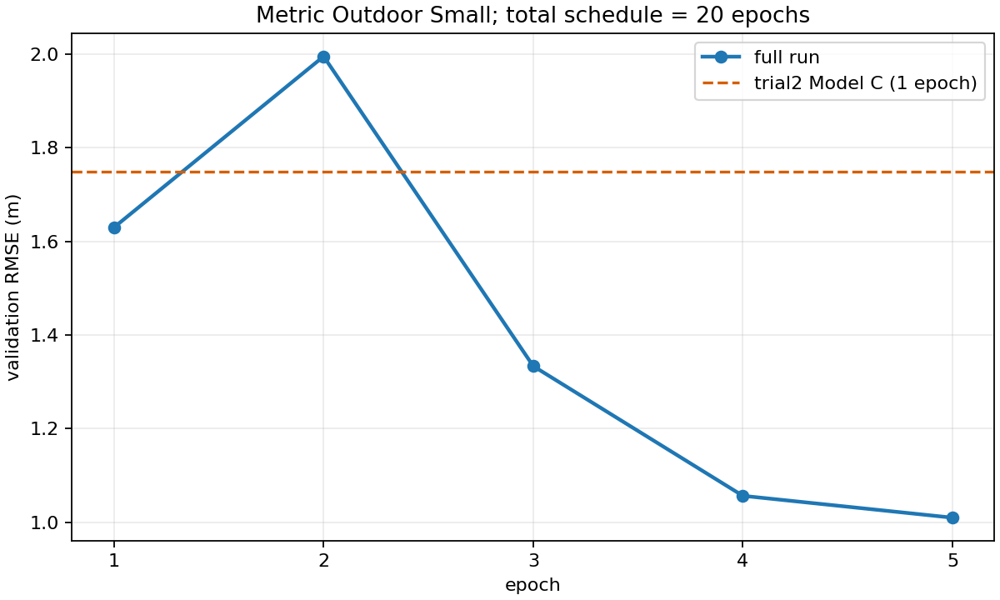

# UAV農作物画像のDepth Anything V2適応研究

Depth Anything V2 SmallをUAV農作物画像へ適応し、絶対深度と局所深度構造を評価する研究である。将来の稲の高さ推定に向けた基礎検討であり、現在のGTは**カメラ座標系のZ-depth**である。垂直草丈そのものではない。

**現在の確定状態：第3回runは20 epoch計画の5 epoch完了・15 epoch残、`paused_after_epoch`。** 無料Colab GPUの利用制限によりepoch 6以降は未実施。独立test 319組は未取得・未使用、過去52組は今回の学習・モデル選択に未使用。稲の垂直高さ推定精度は未検証である。

通常の編集・分析・図表・論文・Git作業はWindowsのこのローカルプロジェクトを正本とする。Driveは大容量データ、checkpoint、Colab受け渡しとバックアップ、Colabは明示的に許可されたGPU実験に使用する。[運用ルール](docs/WORKFLOW_JA.md)を参照。

## モデルと主な結果

共通validation 128画像（Day047）、GT有効上限65m。局所14px MAEは元解像度の全有効ペアによる集計である。

|モデル|初期化・学習|出力上限|MAE m|RMSE m|AbsRel|Pearson|局所14px MAE m|
|---|---|---:|---:|---:|---:|---:|---:|
|A|Relative Small encoder＋新Metric head、1 epoch|65m|2.4897|3.9063|0.12120|0.8712|0.10545|
|B|未追加学習のMetric Outdoor Small|80m|13.2730|14.5340|0.65896|0.7848|0.06561|
|C|Metric Outdoorから1 epoch追加学習|80m|1.1324|1.7490|0.05208|0.9773|0.06800|
|D|元のMetric Outdoorから独立した20 epoch計画、epoch 5|80m|0.7373|1.0094|0.03694|0.9919|0.06148|

DはCのcheckpointからの継続ではない。CとDではscheduler総期間等も異なるため、差をepoch数だけの効果とは断定しない。

|D epoch|学習SiLog|validation RMSE m|AbsRel|局所14px MAE m|GT差≥20cm MAE m（標本）|振幅比（標本）|符号一致率（標本）|
|---:|---:|---:|---:|---:|---:|---:|---:|
|1|0.10622|1.6299|0.05088|0.06537|0.35276|0.3046|78.28%|
|2|0.05288|1.9953|0.08907|0.06339|0.34543|0.3263|80.24%|
|3|0.03596|1.3334|0.05726|0.06299|0.34708|0.3228|80.82%|
|4|0.03025|1.0562|0.03913|0.06237|0.34495|0.3428|80.52%|
|5|0.02794|1.0094|0.03694|0.06148|0.34090|0.3304|81.02%|

GT差≥20cmの振幅比はepoch 5でも約0.33で、大きいZ-depth差の過小推定が残る。ゼロ差分基準の局所MAEは0.06421mであり、総局所MAEだけで形状を評価できない。Aの局所誤差増分は画像端128px未満へ強く集中し、512px以上の内部では相対順位が変わった。詳細指標は固定標本と全ペアを区別して読む。

## データと学習条件

UAV3DCropのCorn/Oat/Wheat/Soybeanを用いる。train 384組はDay019/028/040、validation 128組はDay047。512組・1024ファイル・7,850,330,776 bytes。分割は撮影日単位で固定し、[manifest](configs/uav3dcrop_verified/)を保持する。`independent_test.csv`は選択計画の記録のみで、実データ取得・評価を意味しない。

入力518、batch 1、gradient accumulation 4、AMP、seed 42、AdamW（weight decay 0.01）、encoder LR 5e-6／neck-head LR 5e-5、SiLog。DはPolynomialLR(power=0.9)、総1920予定optimizer stepsを維持する。AMP skip時にschedulerを進めない。出力係数80mとGT mask上限65mは別設定である。

学習は無料Colab Tesla T4。第3回記録環境はPython 3.13.15、torch 2.11.0+cu130、transformers 5.18.0、NumPy 2.1.3、safetensors 0.8.0。ローカルCPU環境とは異なる。再開署名は実行時ライブラリ版も検査するため、環境不一致を無効化しない。

## 構成と再現

```text
src/da2_experiments/        従来の評価・幾何処理
src/uav_metric_research/    今後のローカル作業用の検証・受け渡し補助
uav_metric_finetuning/      既存の学習準備コード（移行前の内容を保存）
experiments/               第1〜3回の固定コード・結果・ログ・run metadata
configs/uav3dcrop_verified/ 固定分割manifest
notebooks/                 出力・個人用metadataを除いた実行Notebook
reports/                   各回日本語報告書と既存研究資料
papers/                    最新30ページ論文・LaTeX・図・参考文献
figures/                   主要図への索引・出典
checksums/                 実験時ソースのSHA256一覧
scripts/                   従来実行コードとローカル受け渡しCLI
docs/                      運用・移行記録・大容量資産の所在
data/, work/               ローカルのみ。Git対象外
```

最初にCPUで以下を実行する（モデル・データの取得やGPU実行なし）。

```powershell
.\.venv\Scripts\python.exe scripts/research_workspace.py verify
.\.venv\Scripts\python.exe -m unittest discover -s tests -p "test_research_workspace.py" -v
.\.venv\Scripts\python.exe -m unittest discover -s uav_metric_finetuning/tests -v
.\.venv\Scripts\python.exe scripts/research_workspace.py bundle --output work/colab_bundles/trial3_resume_code.zip
```

第3回を再開するときは`experiments/metric_outdoor_full_20261014_s42_518_cap80_gt65/source_full_v1/`を**無改変**で使う。元のCLIをrun metadataから復元し、変更可能なのは承認された停止epochと新しいVRAM事前計測report等の非署名項目だけである。モデル・optimizer・scheduler・scaler・乱数状態を復元する。総20epoch・出力80m・GT65mを変更しない。[再開用Notebookの説明](notebooks/README_JA.md)と[資産復元](docs/REMOTE_ASSETS_JA.md)を参照。

## 報告書・図

- [第1回報告](reports/trial1_execution_report_ja.md)、[第2回原報告](reports/trial2_report_ja.md)、[第2回の後続ローカル検証版](reports/trial2_report_verified_20261014.md)、[第3回報告](reports/trial3_report_ja.md)
- [最新論文PDF](papers/interim_finetuning_report_20261014/paper_ja.pdf)、[LaTeX](papers/interim_finetuning_report_20261014/paper_ja.tex)、[根拠一覧](papers/interim_finetuning_report_20261014/evidence_manifest.csv)、[後から確認できた環境情報の補記](papers/interim_finetuning_report_20261014/MIGRATION_ADDENDUM_JA.md)
- [第2回の比較図29枚](experiments/metric_shape_20261013T123006472484Z/analysis/figures/)、[第3回CSV/JSONと5曲線](experiments/metric_outdoor_full_20261014_s42_518_cap80_gt65/results/)、[図の索引](figures/README.md)
- [従来研究README](docs/archive/README_before_local_migration_20261014.md)には既存のKITTI、ETH3D、稲画像等の説明を保持している。



## 保存・公開方針と課題

RGB/GT、学習重み、optimizer state、全予測cacheはGitへ含めない。Drive原本は残し、[REMOTE_ASSETS.json](docs/REMOTE_ASSETS.json)にID・サイズ・記録済みSHA256を保存する。`checkpoint_metadata/`は軽量な記録だけで、ローカルの完全checkpointではない。画像版互換PDFと元実行Notebookはローカルには保持するがGit対象外。公開Notebookは出力・個人metadataを削除し、固定コードは`.gitattributes`で改行変換を無効化した。

今後は基準runの残り15epoch、局所差分損失、高解像度tile、画像端歪みの要因、未知撮影日の汎化、稲のMetric Depth／垂直草丈GTによる評価を検討する。独立testはモデル選択完了後の最終検証に保留する。今回の移行では追加学習・推論をしていない。

データ出典：UAV3DCrop／UAV3DCrop Depth, Link-Dev（[RGB](https://huggingface.co/datasets/Link-Dev/UAV3DCrop)、[Depth](https://huggingface.co/datasets/Link-Dev/UAV3DCrop_depth)、CC BY 4.0）。図はこれらのRGB/深度を加工した研究用比較図である。[出典・改変表示](figures/ATTRIBUTION.md)を参照。
