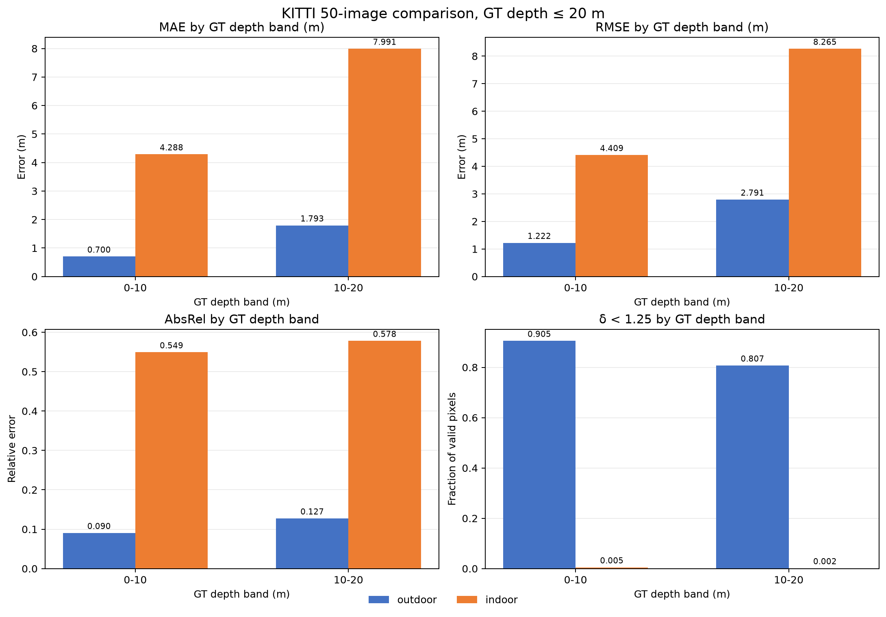
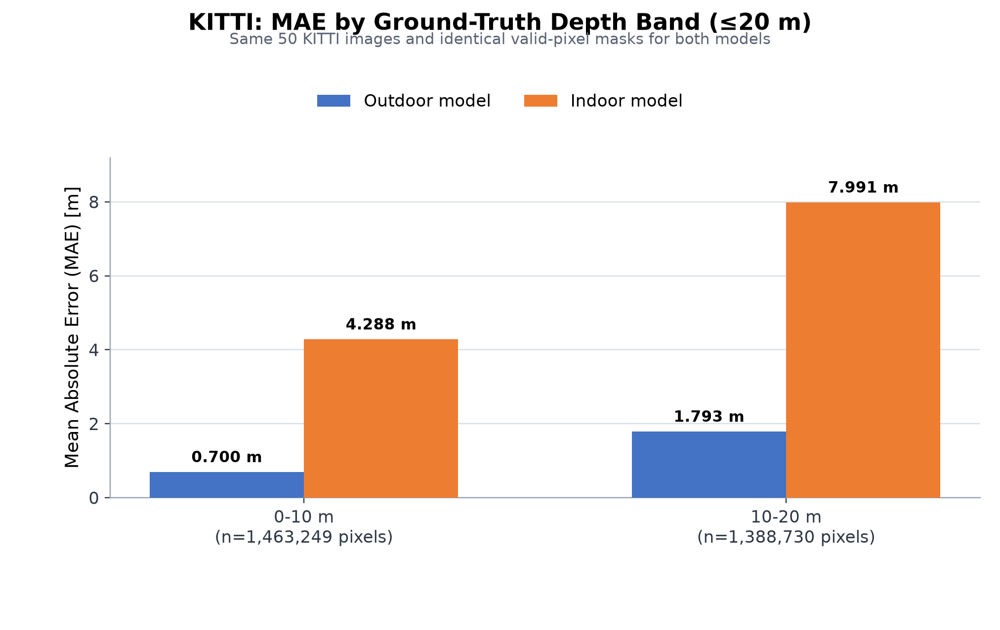

# KITTI 20 m以内の屋内・屋外metric model比較

**実施日:** 2026-10-10
**目的:** KITTIのうちGT深度が20 m以内の領域で、屋内metric modelと屋外metric modelを同じ条件で比較する。

## 結果

評価対象はKITTI validation subsetの同じ50画像である。両モデルで有効画素マスクが画像ごとに一致し、合計2,851,979画素を比較した。

| Model | MAE (m) | RMSE (m) | AbsRel | δ < 1.25 |
|---|---:|---:|---:|---:|
| Outdoor Small | 1.2324 | 2.1354 | 0.1084 | 0.8575 |
| Indoor Small | 6.0914 | 6.5756 | 0.5633 | 0.0034 |

GT距離帯ごとの結果も、屋外modelの誤差が小さかった。

| GT距離帯 | 有効画素数 | Outdoor MAE (m) | Indoor MAE (m) | Outdoor AbsRel | Indoor AbsRel |
|---|---:|---:|---:|---:|---:|
| 0–10 m | 1,463,249 | 0.7002 | 4.2884 | 0.0904 | 0.5491 |
| 10–20 m | 1,388,730 | 1.7932 | 7.9911 | 0.1273 | 0.5782 |

Indoor modelは全体でMAEが屋外modelの4.94倍、RMSEが3.08倍だった。符号付き誤差の平均はIndoorが−6.0876 m、Outdoorが−0.4379 mであり、IndoorはKITTI上の距離を大きく過小推定した。GTとの予測比の中央値はIndoor 0.4457、Outdoor 0.9604だった。





## 実験条件

- データは `data/kitti_validation_50/val_selection_cropped/` の画像50枚と対応GTを使用した。選択元は `data/kitti_validation_50/manifest.json`。
- 屋外modelは `depth-anything/Depth-Anything-V2-Metric-Outdoor-Small-hf`、屋内modelは `depth-anything/Depth-Anything-V2-Metric-Indoor-Small-hf`。
- 公式説明では、屋内modelはHypersim・最大深度20 m、屋外modelはVirtual KITTI 2・最大深度80 mでfine-tuningされている ([公式metric-depth README](https://github.com/DepthAnything/Depth-Anything-V2/blob/main/metric_depth/README.md))。
- 両modelともDepth Anything V2の共通Transformersローダー、画像processor、入力画像、出力解像度、指標計算を使用した。画像ごとのscale fittingやshift補正は行っていない。
- KITTIのuint16 GTを256で割ってメートルへ変換した。評価maskはGTと予測が有限かつ正値で、GT深度が20 m以下の画素とした。20.0 mちょうどの画素は10–20 m帯に含めた。
- Outdoor予測は元の50画像実験で保存した出力を再利用し、今回の20 m条件で再集計した。Indoor予測は同じ50画像に対して新たに推論した。Indoor checkpointはプロジェクト内キャッシュから読み込んだ。
- 今回の比較は、プロジェクトで選んだ50画像のvalidation subset内の結果であり、KITTI全体や稲画像への精度を示すものではない。

## 解釈

「評価を20 m以内に限定すれば屋内modelが有利になる」という予想は、このKITTI subsetでは支持されなかった。距離上限が小さいことだけではmodel選択の理由にならず、屋内modelのHypersim学習domainと道路画像の違いが影響した可能性がある。ただし、この比較だけで誤差の原因をdomain差に特定することはできない。

この結果はKITTI道路画像上の比較であり、稲UAV画像でのmodel優劣を直接決めない。稲画像に対するmetric深度や稲高を主張するには、作物UAV画像と対応するGTを持つデータで別途検証する必要がある。また、metric depthはカメラから見た距離であり、稲高そのものではない。

## 出力と再実行

- `outputs/kitti_20m/outdoor/`、`outputs/kitti_20m/indoor/`: 各modelの予測、metrics JSON、距離帯・画像別グラフ、代表画像。
- `results/metrics/kitti_20m/outdoor/`、`results/metrics/kitti_20m/indoor/`: per-image、summary、距離帯CSVと実行ログ。
- `outputs/kitti_20m/comparison/`: 比較JSONと比較図。
- `results/metrics/kitti_20m/comparison/`: summary、距離帯、画像別の差分CSVとscale diagnostics。
- `scripts/evaluate_kitti.py`: max-depth上限を代表画像とグラフにも適用するよう更新。
- `scripts/compare_kitti_models.py`: 同一画像・同一valid-pixel maskを確認して比較ファイルを生成。

```powershell
$env:HF_HUB_OFFLINE = "1"
& .venv\Scripts\python.exe scripts\evaluate_kitti.py --data-root data\kitti_validation_50 --pred-dir outputs\kitti\predictions --outdir outputs\kitti_20m\outdoor --results-dir results\metrics\kitti_20m\outdoor --model-id depth-anything/Depth-Anything-V2-Metric-Outdoor-Small-hf --max-depth 20 --batch-size 4
& .venv\Scripts\python.exe scripts\evaluate_kitti.py --data-root data\kitti_validation_50 --outdir outputs\kitti_20m\indoor --results-dir results\metrics\kitti_20m\indoor --model-id depth-anything/Depth-Anything-V2-Metric-Indoor-Small-hf --max-depth 20 --batch-size 4
& .venv\Scripts\python.exe scripts\compare_kitti_models.py
```
