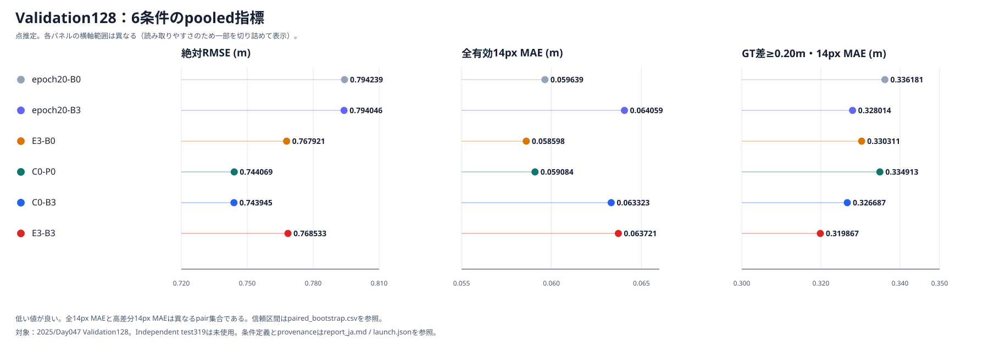

# 既存最良モデルとB3融合推論の組合せ検証

## 要約

本実験では、絶対深度RMSEが良好なC0と、局所Huber損失で学習したE3に、固定済みB3型の全体・タイル融合推論を適用した。新規に学習は行わず、C0-B3とE3-B3をValidation128画像で推論した。epoch20-B0、epoch20-B3、E3-B0、C0-P0の4条件は、検証済み画像別十分統計を再利用した。

C0-B3は六条件中、RMSEの点推定が最小（0.743945m）であったが、C0-P0との差は0.000123mに過ぎず、画像単位bootstrapの95%区間は0を含んだ。E3-B3は高差分14px固定pair MAEが六条件中で最小（0.319867m）となった。B3融合はC0、E3のどちらでも大きな局所差分の誤差を下げたが、全14px pair MAEを増加させた。従って、絶対深度と局所差分を同時に一意に最適化する単一条件は確定しない。

## 1. 目的と事前固定条件

目的は、同一checkpointによる短辺518pxの全体推論と元画像座標の局所タイル推論をB3式で融合し、モデル選択と推論方式の組合せが絶対深度と局所深度差に与える影響を比較することである。検証対象はT1=C0-B3およびT2=E3-B3であり、比較対象はepoch20-B0、epoch20-B3、E3-B0、C0-P0である。C0-B3およびE3-B3はいずれも全体・タイルの両方に同一checkpointを使用した。異なるcheckpoint同士の融合はしていない。

- 分割：2025/Day047 Validation128のみ。Independent test319は使用していない。
- GT mask：finiteかつ0 < Z <= 65m。
- 固定pair manifest：SHA256 `bcb56eab03bec4a44f0626da0f4814876fae67774e536e00cd9f1ad16b1f5728`。
- Validation manifest：SHA256 `96c4eab0eb0075ac141ff9b17c22a45734f242f7cc895f8eaf064a4f14cc871e`。
- RGB入力：uint8、RGB、HxWx3、0–255。既存前処理で一度だけ0–1へ変換し、ImageNet正規化する。
- タイル：元画像上2000×2000px、モデル入力518px、公称overlap 25%、遠端anchoring、正のHann重み。
- B3：`L(D_global) + D_tile - L(D_tile)`。Lは元画像座標上の215×215正規化box filter、境界は`BORDER_REFLECT_101`。
- FP32、TF32無効。評価値のclipping、GTを使ったscale/offset補正、結果を見た融合係数調整はしていない。範囲外値もそのまま採点した。

使用モデルはDepth Anything V2 Metric Outdoor Smallである。C0 epoch5 checkpoint SHA256は `2fd190727c7a5124c56c1e0ea2dd8cb09c6cb62a0f92b34fce97ad394281b35a`、正式選択済みE3 epoch5 checkpoint SHA256は `223b75d1f5d81844bc5702565a8291270a8ae951d6e8e7c12be9f1b3ad12e886` である。base epoch20モデルのsafetensors SHA256は `52769e2e95704d0862e708e8772195b861c647dd4812058eaf698a44305c3bcb` である。checkpointはstrict loadし、モデルをevalモードに固定した。

## 2. 実行と再現ゲート

推論はGPGPU4（NVIDIA GeForce GTX 1080 8GB）で行った。実行環境はSingularity image `pytorch_2.11.0_cuda12.6_cudnn9_runtime.sif`、PyTorch 2.11.0+cu126、CUDA 12.6、NumPy 2.1.3、OpenCV 4.14.0であった。実行run IDは `20261122T042859Z-35268` である。GPU上の新規推論はC0、E3それぞれ128枚で完了し、合計256画像・2条件である。過去4条件の十分統計は同じValidation128、GT mask、pair manifestに整合する既存結果から読み込んだ。

正式推論の前にepoch20-B3の固定代表画像1枚で、保存済み画像別統計との再現を確認した。RMSEは0.721257783014m（保存値0.721257783153m）、全14px MAEは0.055665342704m（保存値0.055665322186m）、高差分14px MAEは0.341716400005m（保存値0.341716369159m）であり、いずれも差は1e-5m未満であった。strict checkpoint load、RGB値域、推論出力の有限性とB3融合処理もsmoke runで確認した。

新規条件各128画像で有効深度画素数は2,668,757,375、全14px pair数は5,320,891,492、高差分14px pair数は1,911,836である。高差分pairを1つ以上持つ画像は126枚であった。高差分pairがない画像の局所平均は未定義として扱い、0に置換していない。

## 3. 集計結果

以下の表はpooled推定値である。深度誤差はm、AbsRelは無次元、Pearsonは相関係数である。epoch20-B0/B3のbiasは元の十分統計に符号付き誤差和がないため未提供である。

| 条件 | 絶対MAE | 絶対RMSE | AbsRel | Bias | Pearson | 全14px MAE | 高差分14px MAE |
|---|---:|---:|---:|---:|---:|---:|---:|
| epoch20-B0 | 0.573505 | 0.794239 | 0.029186 | — | 0.994368 | 0.059639 | 0.336181 |
| epoch20-B3 | 0.573115 | 0.794046 | 0.029172 | — | 0.994368 | 0.064059 | 0.328014 |
| E3-B0 | 0.552444 | 0.767921 | 0.028016 | 0.060884 | 0.994712 | 0.058598 | 0.330311 |
| C0-P0 | 0.531744 | 0.744069 | 0.026789 | −0.003907 | 0.995057 | 0.059084 | 0.334913 |
| C0-B3 | 0.531556 | **0.743945** | 0.026785 | −0.004118 | 0.995055 | 0.063323 | 0.326687 |
| E3-B3 | 0.552549 | 0.768533 | 0.028029 | 0.060665 | 0.994700 | 0.063721 | **0.319867** |

pooled MAEは全有効画素または全pairをまとめた値であり、画像平均とは別の推定量である。高差分14px MAEの画像平均は、epoch20-B0=0.328821m、epoch20-B3=0.316391m、E3-B0=0.323711m、C0-P0=0.327642m、C0-B3=0.314894m、E3-B3=0.308966mであり、最小はE3-B3であった。pooledの高差分指標を主結果として報告し、画像平均を別に併記した。

新規条件の高差分14px局所RMSEはC0-B3=0.551930m、E3-B3=0.547721mであった。高差分振幅比はそれぞれ0.403560、0.410190、符号一致率は0.848229、0.853934である。これらは既存4条件について同じ集計欄が揃っていないため、新規2条件の診断値としてのみ報告する。

絶対深度の点推定上の最小RMSEはC0-B3の0.743945mで、次点C0-P0の0.744069mとの差は0.0166%である。一方、全14px MAEの最小はE3-B0、高差分14px MAEの最小はE3-B3である。六条件のPareto非劣解はE3-B0、C0-P0、C0-B3、E3-B3であった。

図1. pooled点推定の比較。パネルごとに表示軸の範囲が異なるため、数値はラベルで直接比較する。信頼区間は `results/20261122T042859Z-35268/analysis_reconciled_d99d8ec/paired_bootstrap.csv` を参照。

## 4. 対応付き画像bootstrap

画像IDを対応させたpaired bootstrapを10,000回、seed 42で行った。pooled推定量では画像単位の誤差和・二乗誤差和・有効画素数またはpair数を同じ再標本化で集約した。画像平均推定量では、各画像の指標を画像単位で平均した。高差分pairのない画像の局所指標は未定義として除外した。以下はpooled差（A−B）と相対変化の95%区間である。負の差がAの誤差低下を表す。

| 比較 | 指標 | 点差 | 95% CI（差） | 相対変化 | 95% CI（相対%） |
|---|---|---:|---:|---:|---:|
| C0-B3 − C0-P0 | RMSE | −0.000123m | [−0.001294, 0.001122] | −0.02% | [−0.18%, 0.15%] |
| C0-B3 − C0-P0 | 全14px MAE | +0.004239m | [+0.003791, +0.004701] | +7.17% | [+5.98%, +8.57%] |
| C0-B3 − C0-P0 | 高差分14px MAE | −0.008226m | [−0.009581, −0.006911] | −2.46% | [−2.88%, −2.06%] |
| E3-B3 − E3-B0 | RMSE | +0.000612m | [−0.000645, +0.001947] | +0.08% | [−0.08%, +0.26%] |
| E3-B3 − E3-B0 | 全14px MAE | +0.005123m | [+0.004603, +0.005661] | +8.74% | [+7.35%, +10.38%] |
| E3-B3 − E3-B0 | 高差分14px MAE | −0.010444m | [−0.011927, −0.009021] | −3.16% | [−3.64%, −2.72%] |
| C0-B3 − epoch20-B3 | RMSE | −0.050101m | [−0.073558, −0.027264] | −6.31% | [−9.15%, −3.47%] |
| C0-B3 − epoch20-B3 | 全14px MAE | −0.000736m | [−0.000810, −0.000666] | −1.15% | [−1.30%, −1.01%] |
| C0-B3 − epoch20-B3 | 高差分14px MAE | −0.001327m | [−0.001571, −0.001079] | −0.40% | [−0.48%, −0.33%] |
| E3-B3 − epoch20-B3 | RMSE | −0.025513m | [−0.041714, −0.009449] | −3.21% | [−5.19%, −1.22%] |
| E3-B3 − epoch20-B3 | 全14px MAE | −0.000338m | [−0.000545, −0.000133] | −0.53% | [−0.81%, −0.22%] |
| E3-B3 − epoch20-B3 | 高差分14px MAE | −0.008147m | [−0.008777, −0.007492] | −2.48% | [−2.71%, −2.27%] |
| C0-B3 − E3-B3 | RMSE | −0.024588m | [−0.044360, −0.005535] | −3.20% | [−5.72%, −0.72%] |
| C0-B3 − E3-B3 | 全14px MAE | −0.000398m | [−0.000596, −0.000198] | −0.62% | [−0.99%, −0.29%] |
| C0-B3 − E3-B3 | 高差分14px MAE | +0.006820m | [+0.006261, +0.007375] | +2.13% | [+1.93%, +2.34%] |

画像平均のpaired bootstrapも同じ成果CSVに保存してある。CSVは事前指定した5比較について、RMSE・全14px MAE・高差分14px MAEのpooledとimage-mean推定量をすべて収録している。多くの比較・指標を同じValidation128で調べた探索的解析であり、多重比較補正を行っていない。bootstrap区間を独立検証の代替やモデルの汎化保証として解釈しない。

## 5. 推論時間とメモリ

RTX 1080での新規推論時間はC0-B3が164.406秒（128枚、平均1.284秒/枚、中央値1.285秒、p95 1.294秒）、E3-B3が163.003秒（平均1.273秒/枚、中央値1.274秒、p95 1.278秒）であり、合計327.409秒であった。PyTorchのピークallocated memoryはC0-B3=244.6MiB、E3-B3=245.2MiBである。これはPyTorchが追跡した割当ピークであり、GPU全体の占有量ではない。実行前GPU状態は0% utilization、2047MiB使用、6066MiB空きであった。

## 6. 結果の解釈

### C0-B3とC0-P0

C0-B3のRMSEはC0-P0より点推定で0.000123m低いが、95% CIは0を含み、実質的・統計的な差を主張できない。高差分14px MAEは2.46%低下した一方、全14px MAEは7.17%上昇した。大きな差分を優先すると改善が見られるが、一般の14px pair全体では悪化するため、「B3がC0の局所差分性能を一様に改善した」とは言えない。

### E3-B3とE3-B0

E3-B3はE3-B0に比べ、高差分14px MAEを3.16%低下させた。全14px MAEは8.74%上昇し、RMSE差の95% CIは0をまたぐ。したがって、B3は大きな差分の点推定を改善する一方、全局所差分では悪化する。RMSEを含めて無条件に優越する結果ではない。

### 現時点の用途別候補

- 絶対RMSEの点推定：C0-B3（0.743945m）。C0-P0との差は非常に小さく、paired bootstrap区間は0を含むため同等域の候補として扱う。
- 全有効14px局所MAE：E3-B0（0.058598m）。
- 高差分14px局所MAE：E3-B3（0.319867m）。ただしRMSEは0.768533m、全14px MAEは0.063721mであり、絶対深度の最良条件ではない。
- 3指標のPareto候補：E3-B0、C0-P0、C0-B3、E3-B3。指標の優先度に応じて選択すべきで、総合点は作成していない。

## 7. 監査上の訂正履歴

初回の集計出力 `analysis_final_d99d8ec` は、参照した旧analyzerが不正な条件間局所行を混在させていたことが判明したため無効である。初回出力は消去せず、NFSバックアップの `results/analysis_final/INVALID.md` に理由を記録した。旧値を正式結果として引用していない。

修正analyzerはブランチcommit `d99d8ecd4efcfa2863f34eaa130b87033088c96a` と一致するSHA256 `e23374dc10281711d0c64a698c160edccb0561035e899f0f3c8d401b27a022ec` を持つ。修正出力 `analysis_reconciled_d99d8ec` はC0-B3/E3-B3の新規推論runに保存された画像別十分統計と照合し、整合性確認を通過した。正式結果として参照するのはこの出力である。

修正前後比較は、旧出力の誤った数値を結論として流用せず、無効出力を監査対象として区別した。再集計後の主要値・bootstrapは `condition_summary.csv` と `paired_bootstrap.csv` に丸め前で保存した。

## 8. 固定8画像の可視化、限界、今後

事前固定したValidation128のimage index [7, 20, 34, 48, 71, 89, 97, 112]を対象に、6条件を同じ元画像座標で並べた比較図を作成した。深度比較8枚と絶対誤差比較8枚の計16枚であり、結果は `figures/fixed8_visualizations_20261123/` に保存した。各深度図はRGB、GTおよび6条件の予測深度を含み、誤差図は同一のGT有効画素maskにおける条件別絶対誤差を示す。

深度図の色範囲は全画像・条件共通の0–65m、絶対誤差図は0–10mである。誤差の10m超は図の表示上のみ上限にクリップし、実測値は変更していない。超過画素数・割合、予測値の非正数・80m超数は48行の画像別CSVに記録した。GTの無効画素は全パネルで除外した。8画像は図の見やすさに基づいて選び直しておらず、固定manifestに従った。

視覚比較は固定8画像の記述的診断であり、Validation128全体の定量指標やbootstrapを置き換えない。画像ごとの印象から改善の因果や全標本の形状傾向を断定しない。数値評価とモデル選択は第3–6節のValidation128集計を正本とする。

複合PNG16枚のGitHub掲載は、2026年11月23日にユーザーから明示的な許可を得て行った。画像にはRGB・GTの表示が含まれる。元のRGB/GTファイル、checkpoint、prediction cacheは公開していない。生成時provenanceに記録された生成時の公開区分と、生成後に得た掲載許可は `results/fixed8_visualization_20261123/FIGURE_PUBLICATION_NOTE_JA.md` に分けて記録した。

本評価はValidation128をモデル・推論条件の比較に繰り返し用いた探索的評価であり、seedは学習条件ごとに単一である。同一撮影日・限られた作物・飛行条件に依存する可能性があり、Independent test319を未使用であるため一般化性能は未検証である。画像単位bootstrapは画像間の不確実性を示すが、分布シフト、多重比較、学習seed間分散を解消しない。B0基準の一部符号付き統計が不足する制約も残る。

### 視覚確認記録

図の目視確認は未完了である。GitHub公開後に全16枚を実際に確認し、結果を追記する。生成数、画像寸法、共有色範囲、SHA256検査は完了している。
## 9. 成果物と再現

- 条件別集計：`results/20261122T042859Z-35268/analysis_reconciled_d99d8ec/condition_summary.csv`
- bootstrap再現に必要な画像別十分統計（6条件×128画像、768行）は `analysis_reconciled_d99d8ec/per_image_sufficient_statistics.csv` に含めた。元の詳細 `condition_per_image.csv` はNFSバックアップに保全した。公開用十分統計の列別合算を条件別pooled summaryと照合し、絶対MAE/RMSE・全14px MAE・高差分14px MAEの差が1e-12未満であることを確認した。
- Bootstrap：`results/20261122T042859Z-35268/analysis_reconciled_d99d8ec/paired_bootstrap.csv`
- Pareto表：`results/20261122T042859Z-35268/analysis_reconciled_d99d8ec/pareto.csv`
- 推論provenance：`results/20261122T042859Z-35268/full_eval/launch.json` と `run_complete.json`
- 正確なCLI引数、GPU、container、manifest SHA、checkpoint SHA、推論source hashは `launch.json` に記録した。推論source snapshot revisionは `3e78744c24827717e1e746663b260b32f3f2f55e`、実行ファイル `run_b3.py` のSHA256は `6ae45abea44847982bb7eeea3f165153eddfae31c6bb8f6ad3de0598662d9c4b` であり、空白を除いた完全値は `6ae45abea44847982bb7eeea3f165153eddfae31c6bb8f6ad3de0598662d9c4b` である。集計analyzerはcommit `d99d8ec` である。
- NFS保全先：`/home1/eng-std/s0623003/gpu4_research_backup_best_model_inference_combination_20261122_1420`。39ファイル、約1.2MB。`SHA256SUMS`照合は完了。

新規結果は `analysis_reconciled_d99d8ec/` のCSV、`full_eval/` のprovenance、`SHA256SUMS`を正本とする。推論用コマンド全体は `full_eval/launch.json` の `command_line` と `PLAN_JA.md` を参照する。実行時source snapshotにGit metadataが無かったため、記録済みrevisionと各source hashを併用している。
