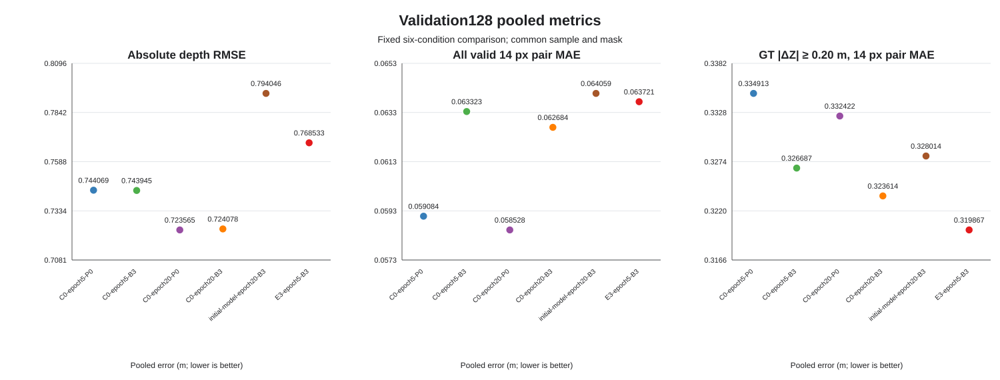
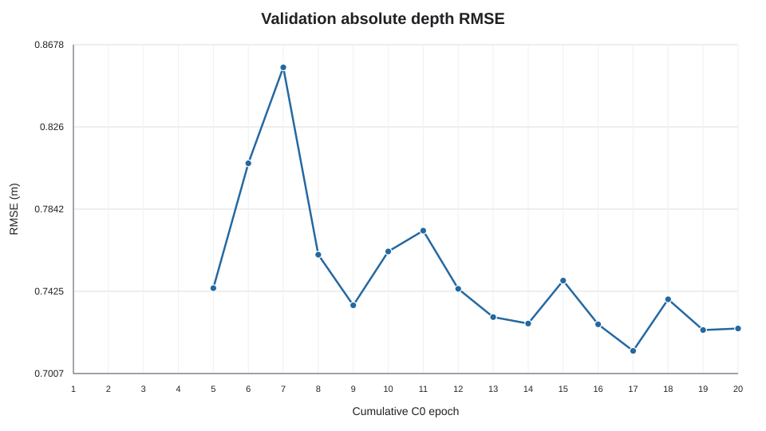
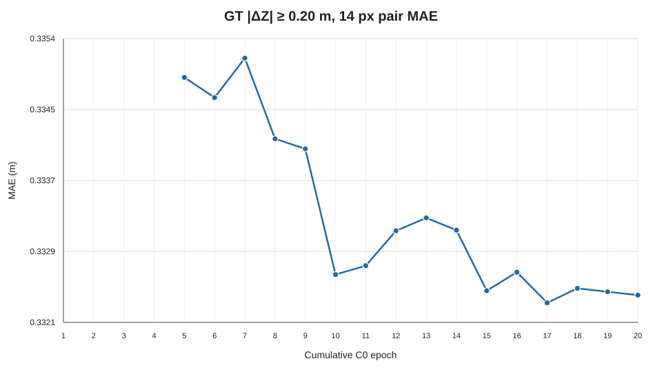
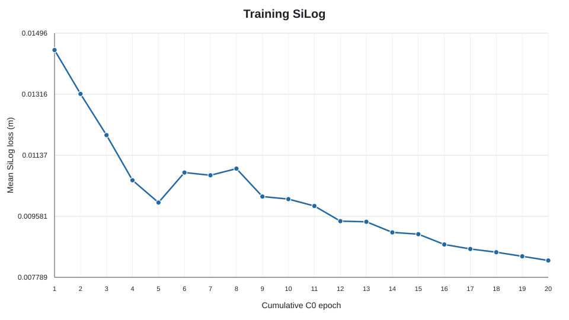

# C0追加15 epoch学習の結果報告

## 1. 目的と事前固定条件

C0のepoch5 checkpointからepoch6〜20の15 epochを追加し、学習を継続した場合の絶対深度誤差と局所深度差誤差の変化をValidation128で調べた。新規モデルをゼロから学習した実験ではない。学習群はC0のみであり、F1、F2、E3の再学習は行っていない。主評価checkpointは開始前にepoch20へ固定した。

追加フェーズではepoch5のmodel、AdamW moment、GradScaler、RNG状態を復元した。既存5 epoch schedulerは終端であったため、AdamW状態を保ったまま、encoder LRを1e-6、neck/head LRを1e-5に再設定し、2,880 successful updateを対象にPolynomialLRを新規設定した。このため本実験は、同一schedulerの20 epochを連続実行した条件とは異なる。

## 2. データと評価方法

Train384を用い、各画像からepochあたり2 crop、合計768 cropを生成した。C0の元画像短辺518pxへのbicubic縮小、518×518 crop、GT nearest resize、SiLog損失、batch 1、gradient accumulation 4、seed 42、FP16 GradScalerを維持した。GT学習範囲は0.001〜65m、予測上限は80mである。

各epochでValidation128をP0方式で評価した。評価maskはfiniteかつ0 < depth <= 65mであり、元画像座標の固定14px pair manifestを用いた。独立test319は使用していない。epoch20では同じcheckpointで既存B3融合を別途評価した。B3は短辺518px全体推論と2000px原画像タイル推論（モデル入力518px、公称重複率25%、正Hann融合）を行い、215px box filterを用いて L(D_global) + D_tile - L(D_tile) とした。

## 3. 学習完了とチェックポイント

epoch6〜20の15 epochが完了した。各epochで768 crop、192 successful optimizer updateを行い、AMP skipは全epochで0回であった。累積global_stepは960から3,840へ進んだ。初期epoch5 checkpointのSHA256は2fd190727c7a5124c56c1e0a2dd8cb09c6cb62a0f92b34fce97ad394281b35aであり、epoch20 checkpointはce7068a619c41775f0d42553510954fc15eb1be15a5cc269f5a485303b2e5fa4である。epoch5〜20の16 checkpointは実体ハッシュを計算し、run記録と照合した。元epoch5 checkpointは上書きしていない。過去の草稿にあった別のepoch20 hashは転記誤りであり、根拠と訂正履歴は[provenance照合記録](results/final_20261127/provenance_reconciliation_ja.md)に残した。

## 4. 最終評価

以下は同じValidation128とmaskで得たpooled指標である。高差分14pxは、固定14pxペアのうち|ΔGT| >= 0.2mに限定したMAEである。

| 条件 | 絶対RMSE (m) | 全14px局所MAE (m) | 高差分14px局所MAE (m) |
|---|---:|---:|---:|
| C0 epoch5-P0 | 0.744069 | 0.059084 | 0.334913 |
| C0 epoch5-B3 | 0.743945 | 0.063323 | 0.326687 |
| C0 epoch20-P0 | **0.723565** | **0.058528** | 0.332422 |
| C0 epoch20-B3 | 0.724078 | 0.062684 | 0.323614 |
| 初期モデル epoch20-B3 | 0.794046 | 0.064059 | 0.328014 |
| E3 epoch5-B3 | 0.768533 | 0.063721 | **0.319867** |

学習継続後のC0 epoch20-P0はepoch5-P0より、RMSEが0.020503m（2.76%）、全14px局所MAEが0.000556m（0.94%）、高差分14px局所MAEが0.002491m（0.74%）低下した。対応付きbootstrapでpooled差の95%区間はいずれも0をまたがず、画像平均推定でも同方向であった。改善の大きさは指標間で異なり、局所MAEの差は小さい。

epoch20-B3は同じepochのP0より高差分14px局所MAEを0.008808m（2.65%）低下させたが、全14px局所MAEは0.004156m（7.10%）増加した。RMSE差は+0.000512m（約0.07%）で、paired bootstrapの95%区間は0を含んだ。従ってB3は高差分局所構造に有利だが、全局所ペアでは不利であり、絶対RMSEの差も明確ではない。

epoch20-B3は従来の初期モデルepoch20-B3よりRMSE・全14px・高差分14pxのいずれも低かった。一方、高差分14px MAEはE3 epoch5-B3の0.319867mに及ばず、最良値を更新していない。RMSEと局所差分を一つの総合点へまとめず、用途に応じて条件を区別する。

## 5. epoch推移

epoch6〜20のRMSEは単調減少ではなく、validation上の揺れがあった。最終epoch20はRMSE 0.723565m、全14px局所MAE 0.058528m、高差分局所MAE 0.332422mであり、RMSEの最小値は中間epoch17の0.712205mであった。事前固定したepoch20を主結果として報告し、中間の最小値を主checkpointに置き換えていない。

epoch20のTrain SiLogは0.008283である。訓練損失は継続して低下したが、Validation RMSEは上下したため、単純な「学習を続けるほど改善する」とは言えない。複数の指標が異なる動きを示し、明確な単調改善も一様な過学習も確認できない。epoch1〜5の保存済み記録にはValidation指標がなく、Validation曲線はepoch6〜20を示す。Train SiLog曲線はepoch1〜20を含む。元データは[learning_curve_data.csv](results/final_20261127/learning_curves/learning_curve_data.csv)、学習曲線8図は[learning_curves](results/final_20261127/learning_curves/)に保存した。Validation RMSE、高差分局所MAE、Train SiLogの曲線を以下に示す。

6条件比較図は[condition_summary.svg](results/final_20261127/figures/condition_summary.svg)である。

## 6. 統計解析

画像ID単位の対応付きbootstrapを10,000回、seed 42で実施した。RMSE、全14px局所MAE、高差分14px局所MAEについてpooled集計と画像平均集計を別々に算出した。高差分ペアがない画像の値は0に置かず未定義として処理した。比較差は「左条件−右条件」と定義した。pooled推定量の差と95%区間を示す。完全な24行（pooled・image meanを含む）は[paired_bootstrap.csv](results/final_20261127/analysis/paired_bootstrap.csv)に保存した。

| 比較（左−右） | 指標 | 差 | 95% bootstrap CI |
|---|---|---:|---:|
| C0 epoch20-P0 − epoch5-P0 | RMSE (m) | -0.020503 | [-0.038382, -0.001837] |
|  | 全14px MAE (m) | -0.000556 | [-0.000601, -0.000512] |
|  | 高差分14px MAE (m) | -0.002491 | [-0.002773, -0.002195] |
| C0 epoch20-B3 − epoch5-B3 | RMSE (m) | -0.019868 | [-0.037741, -0.001141] |
|  | 全14px MAE (m) | -0.000639 | [-0.000725, -0.000550] |
|  | 高差分14px MAE (m) | -0.003073 | [-0.003490, -0.002658] |
| C0 epoch20-B3 − epoch20-P0 | RMSE (m) | +0.000512 | [-0.000638, +0.001743] |
|  | 全14px MAE (m) | +0.004156 | [+0.003700, +0.004626] |
|  | 高差分14px MAE (m) | -0.008808 | [-0.010232, -0.007423] |
| C0 epoch20-B3 − E3 epoch5-B3 | RMSE (m) | -0.044455 | [-0.061221, -0.028079] |
|  | 全14px MAE (m) | -0.001037 | [-0.001227, -0.000844] |
|  | 高差分14px MAE (m) | +0.003747 | [+0.003239, +0.004272] |

pooled結果では、epoch5とepoch20の比較は両推論方式とも3指標で改善方向の区間であった。epoch20のB3とP0のRMSE差は区間が0を含み、全14px MAEはB3で悪化、高差分14px MAEは改善した。epoch20-B3とE3 epoch5-B3ではRMSE・全14px MAEはepoch20-B3が低く、高差分MAEはE3が低い。image mean推定量もCSVに別記し、pooled値と混同しない。

事前固定比較は、C0 epoch20-P0対epoch5-P0、C0 epoch20-B3対epoch5-B3、C0 epoch20-B3対epoch20-P0、C0 epoch20-B3対E3 epoch5-B3である。bootstrap区間はvalidation画像単位の不確実性を示すもので、seed間のばらつきや独立データへの汎化を保証しない。複数のvalidation比較による探索バイアスも残る。

## 7. 実行環境と検証

GPGPU4のGeForce GTX 1080 8GBで実施した。正式runは2026-11-26 22:28 JSTに開始し、GPU上のローカル領域/localdata/s0623003/c0_extended_training_20261126/へ保存した。推論はeval/inference modeで行い、学習終了後の最終評価・解析過程に学習更新はない。B3 Validation128の総推論時間は153.52秒であった。GPU使用率は終了時0%であり、当実験の学習・評価プロセス終了を確認した。他ユーザーの既存プロセスは停止・変更していない。

epoch5〜20のcheckpoint、epoch別validation、run metadata、画像別十分統計、bootstrap、学習曲線データ、B3出力、テストログをNFSの新規バックアップへ保存し、SHA256 manifestで照合した。NFSバックアップは110ファイルを保持し、106ファイルのコピー検証が成功した。bootstrap、解析provenance、学習曲線CSV・SVG 8図、初回テストログなどローカルへ転送した12ファイルは、NFSのSHA256SUMS.sourceとすべて一致した。ファイル別のローカルハッシュ一覧は[SHA256SUMS.local.txt](results/final_20261127/SHA256SUMS.local.txt)、NFS検証記録は[SHA256SUMS.verify.final.log](results/final_20261127/SHA256SUMS.verify.final.log)に保存した。GPU環境での直接再実行では16件・12件・1件の各テスト群がすべて成功し、総合終了コード0を確認した。再実行ログは[unittest_direct_rerun_20261127.log](results/final_20261127/logs/unittest_direct_rerun_20261127.log)に保存した。初回ログには各群のOK表示に続き、終了コードを集約するshell wrapperのエラーがあったため、個別suiteを直接再実行して終了コードまで確認した。ローカルGit成果物にはcheckpoint本体、原画像、GT、予測cacheを含めない。

P0評価のprovenanceには制約が残る。元の`evaluation_C0_P0.json`にはcheckpoint path/hashがなく、解析時の`analysis_provenance.json`でも`epoch20_p0_checkpoint_sha256`はnullである。P0評価のgroup・epoch・method、run metadata、NFS上のepoch20 checkpoint hash一覧およびmanifestは照合できたが、評価JSON単体から実チェックポイントを暗号学的に確定できる状態ではない。元ファイルへの後付け記入は行わず、この制約を[provenance照合記録](results/final_20261127/provenance_reconciliation_ja.md)にも残した。

- GPU run: /localdata/s0623003/c0_extended_training_20261126/run_epoch6_20_20261126T222819/
- NFS backup: /home1/eng-std/s0623003/gpu4_research_backup_c0_extended_epoch20_20261127/
- ローカル成果: results/final_20261127/
- 実行時学習コードrevision: e33ec02f772f4bb584403c7dbc4d736c9e2fd66a
- 初期チェックポイントSHA256: 2fd190727c7a5124c56c1e0a2dd8cb09c6cb62a0f92b34fce97ad394281b35a
- epoch20チェックポイントSHA256: ce7068a619c41775f0d42553510954fc15eb1be15a5cc269f5a485303b2e5fa4

## 8. 結論と限界

C0 epoch5から15 epoch継続したepoch20-P0では、Validation128上の絶対RMSEと局所MAEがepoch5-P0より小さくなった。ただし局所差分の改善は0.74〜0.94%で小さい。epoch20-B3は高差分局所MAEをさらに下げる一方で全14px局所MAEを上げ、P0との明確な総合優位は示さなかった。E3 epoch5-B3は高差分14px局所MAEの最小値を維持している。

この結果は単一seedで、同じValidation128をepochごと・既存実験でも繰り返し使用した探索的評価である。epoch6に学習率スケジュールを再設定している。独立test319による汎化確認は行っておらず、別seed・別撮影日・独立圃場への性能は未確定である。結論はValidation128内の比較に限る。

## 9. 公開状況

実験コード、設定、報告書、集計CSV、bootstrap、SVG図表、provenance、SHA256台帳、テストログをGitHubの[PR #9](https://github.com/hw02l/depth-anything-v2-uav-rice-research/pull/9)へ公開した。PRは`research/best-model-inference-combination-20261122`をbaseとし、確認時点でopen・未mergeである。checkpoint本体、生RGB/GT画像、prediction cacheは公開対象から除外した。
