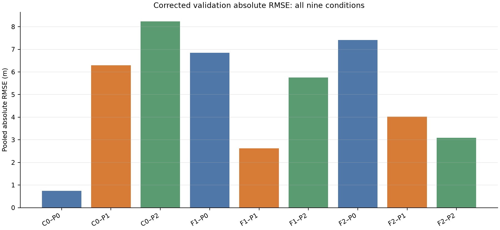
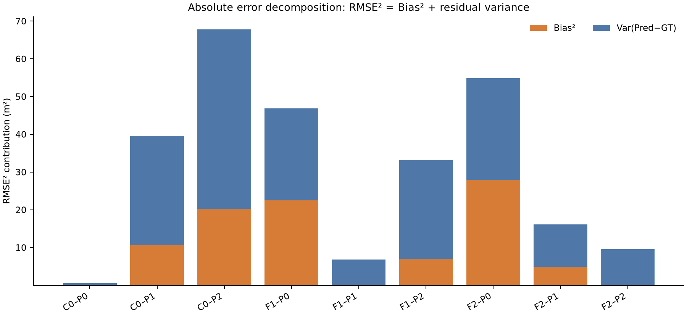
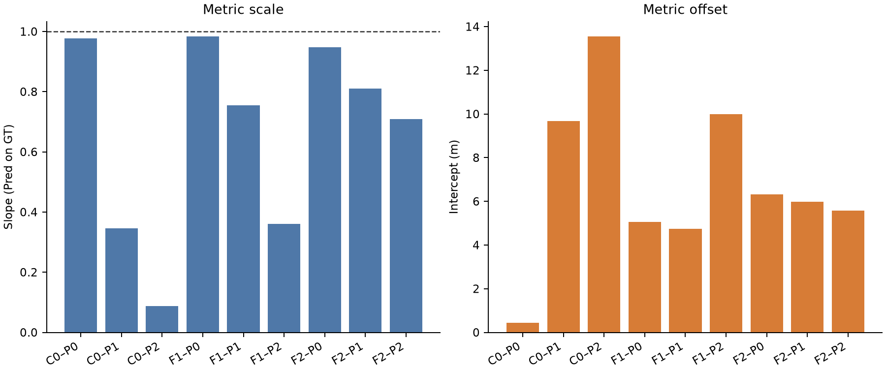
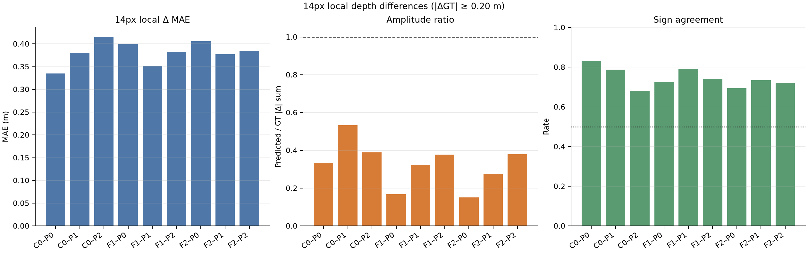
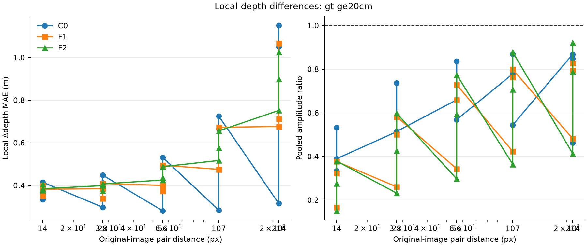

# 深度推定における絶対誤差と局所深度差圧縮の原因分析

**分析日：2026年11月19日**  
**対象：Depth Anything V2 Metric Outdoor Smallを用いたUAV農作物画像のValidation128**

## 1. 研究背景

元解像度から局所cropを学習し、タイル推論で細部を保持する実験では、局所深度差の改善を期待していた。しかし、修正済み評価でも推論方式により絶対深度RMSEが大きく変化し、局所深度差の振幅は依然として小さい。高解像度入力が改善に結び付かなかった理由を、絶対深度の校正、入力スケール、局所差、撮影条件、タイル境界の観点から整理する。

深度GTはカメラ座標系のZ-depthである。作物の鉛直方向の高さや生育量そのものとして扱わない。

## 2. 今回の目的

次の問いを保存済み評価結果から検証する。

1. タイル推論・高解像度crop学習で絶対深度RMSEが悪化する要因は何か。
2. 元画像14px程度の局所深度差が過小推定される要因は何か。
3. 学習と推論で入力尺度を揃えることは、誤差とどのように関係するか。
4. 撮影方向、作物、深度帯、画像端、タイル境界で誤差はどう変わるか。
5. 現時点の証拠で支持できる原因と、未判定の原因は何か。

## 3. 既存実験と評価値の扱い

今回用いた中心資料は、2026年11月15日に確定したC0/F1/F2 × P0/P1/P2の訂正済み評価と、B系列・E系列の既存集計である。2026年11月14日の初回評価はRGB値域不一致によって入力画像の画素情報を失っていたため、旧値・旧結論は無効として再利用しない。訂正済み評価は、PR #6上のfresh reproduction auditでValidation128のB0基準再現と全9条件の再実行が記録されている。監査控えとcheckpoint監査は [`source_evidence/`](source_evidence/) に保存した。

epoch5 checkpointの監査済みSHA256は以下である。

| 群 | SHA256 |
|---|---|
| C0 | `2fd190727c7a5124c56c1e0ea2dd8cb09c6cb62a0f92b34fce97ad394281b35a` |
| F1 | `ae1f74c5ff17cb0266152588b5d53fb824611418f125f2fbf4d9cc7447e49f67` |
| F2 | `8124d72a7008c9f3a93dbce934142d1593063fba2da61a51838e055aaf201538` |

B0 epoch20の基準再現は、MAE 0.573505 m、RMSE 0.794239 m、AbsRel 0.029186、Pearson 0.994368、全14px局所MAE 0.059639 m、GT差20cm以上の14px局所MAE 0.336181 m、振幅比0.332692、符号一致率82.485%である。監査記録では8指標とも過去の基準値と絶対差 `1e-5` 以下で一致した。

| 系列 | 条件 | epoch20絶対RMSE (m) | 読み取り |
|---|---:|---:|---|
| B | B0 whole-image 518 | 0.794239 | 基準 |
| B | B1 whole-image short-side 1036px | 2.420270 | 基準より悪化 |
| B | B2 2000px tile, overlap 25% | 3.853587 | 基準より悪化 |
| B | B3 B2を用いた固定融合 | 0.794046 | 絶対RMSEはB0とほぼ同じ |

B3のGT差20cm以上・14px局所MAEは0.328014 m（B0 0.336181 m）であったが、振幅比は0.401（B0 0.333）に留まり、全ての局所指標が同時に改善したわけではない。融合結果は小幅な局所MAE改善の前例であり、タイル予測間の校正差が今回の全誤差を説明する証明ではない。

| E群 | RMSE (m) | GT差20cm以上・14px局所MAE (m) | 振幅比 | 符号一致率 |
|---|---:|---:|---:|---:|
| E0 | 0.794239 | 0.336181 | 0.3327 | 0.8248 |
| E1 | 0.767838 | 0.334959 | 0.3373 | 0.8275 |
| E2 | 0.771474 | 0.332659 | 0.3358 | 0.8307 |
| E3 | 0.767921 | 0.330311 | 0.3362 | 0.8351 |

E3のE0比局所MAE改善は1.75%で、振幅比はほぼ変わらない。Huber項を加えるだけで局所差の振幅圧縮が解消するとは言えない。

## 4. 誤差要因の仮説

- **入力スケール依存の校正不安定性：** 学習・推論時の局所構造の見え方が異なると、モデル出力の深度オフセットや傾きが変わる。
- **全体文脈の不足：** タイルは視野を狭め、相対的な局所形状を保っても絶対スケールを不安定にする可能性がある。
- **オフセット・倍率ずれ：** pooled Bias、Pred対GTの回帰傾き・切片で差を分けられる。
- **高周波・微小差の縮小：** encoder/downsampling、loss、出力補間、学習分布のいずれかが局所振幅を圧縮する可能性がある。
- **撮影・GT不確かさ：** nadir/oblique、作物、深度帯、写真測量境界の差が観測値に影響する可能性がある。
- **タイル境界：** seamまたは融合が誤差を増やす可能性があるが、領域の難易度と切り分ける必要がある。

これらは相関・説明候補であり、今回の単一seed・単一撮影日データだけで因果関係を確定しない。

## 5. 分析方法

### 5.1 標本と指標

C0/F1/F2 × P0/P1/P2全9条件で同一順序のValidation128画像を使った。各条件2,668,757,375個の有効画素を持ち、GTマスクは `finite and 0 < Z <= 65 m` である。絶対MAE/RMSE/AbsRel/Bias/Pearsonを画像別十分統計から再集計し、訂正済みrelease値と照合した。

局所差は既存固定manifestと同じ座標・画像IDにおける元画像14/28/56/107/214pxペアである。全有効ペアと `|ΔGT| >= 0.20 m` を分け、局所MAE/RMSE、振幅比 `Σ|ΔPred| / Σ|ΔGT|`、非ゼロGT差に対する符号一致率を算出した。14pxで `|ΔGT| >= 0.20 m` のペアは1,911,836組・126画像であった。

### 5.2 pooledと画像平均

pooled指標は全画像の十分統計を先に合算して算出する。画像平均は各画像の指標を等重みで平均する。両者は推定対象が異なる。対応付きbootstrapでは共通の画像IDを10,000回再標本化し、seedを42とした。ゼロペア画像の未定義局所MAEを0として埋めず、pooled指標はペア数で重み付けした。乱数添字のdtypeも訂正済みreleaseと合わせ、対応する24行が既存の正式bootstrap CSVと絶対差 `1e-8` 未満で一致した。

### 5.3 誤差分解とoracle診断

pooled画素について `RMSE² = Bias² + Var(Pred−GT)` を計算し、PredをGTに回帰した傾き・切片・Pearsonを十分統計から再計算した。oracle offset/affine後RMSEは同じGTを使った診断値であり、配備可能な性能や正式な予測値として扱わない。

### 5.4 入力尺度

元画像の14px間隔は、P0のshort-side 518全体縮小では平均約1.83入力px、P1の1036px tileを518pxへ縮小する条件では7入力px、P2の518px tile無縮小では14入力pxとなる。学習でもC0/F1/F2はそれぞれ概ね1.83/7/14入力px相当である。Depth Anything V2のDINOv2 encoderで使われるpatch size 14は参考情報だが、14px未満の差が必ず消えることを意味しない。[DINOv2 model card](https://github.com/facebookresearch/dinov2/blob/main/MODEL_CARD.md)、[Depth Anything V2](https://github.com/DepthAnything/Depth-Anything-V2)。

## 6. 絶対深度誤差

### 6.1 9条件

| 学習–推論 | MAE (m) | RMSE (m) | AbsRel | Bias (m) | Pearson | Pred対GT slope | intercept (m) |
|---|---:|---:|---:|---:|---:|---:|---:|
| C0–P0 | 0.5317 | **0.7441** | 0.0268 | -0.0039 | 0.9951 | 0.9775 | 0.441 |
| C0–P1 | 3.8530 | 6.2918 | 0.1522 | -3.2658 | 0.7452 | 0.3460 | 9.683 |
| C0–P2 | 4.8493 | 8.2345 | 0.1826 | -4.4984 | 0.4567 | 0.0879 | 13.560 |
| F1–P0 | 5.1605 | 6.8495 | 0.2716 | +4.7440 | 0.8288 | 0.9844 | 5.053 |
| F1–P1 | 1.6337 | 2.6166 | 0.0750 | -0.1077 | 0.9483 | 0.7553 | 4.738 |
| F1–P2 | 3.4376 | 5.7527 | 0.1360 | -2.6532 | 0.8203 | 0.3610 | 9.999 |
| F2–P0 | 5.5333 | 7.4095 | 0.2919 | +5.2887 | 0.8060 | 0.9482 | 6.314 |
| F2–P1 | 3.0354 | 4.0205 | 0.1602 | +2.2068 | 0.8921 | 0.8096 | 5.976 |
| F2–P2 | 1.8823 | 3.0840 | 0.0860 | -0.1652 | 0.9231 | 0.7097 | 5.582 |



### 6.2 Biasと残差分散

C0-P1/P2のBias²はRMSE²の26.9%/29.8%、F1-P0は48.0%、F2-P0は51.0%、F2-P1は30.1%である。一方、F1-P1とF2-P2ではBiasは小さいが、RMSEはそれぞれ2.617m、3.084mである。したがって大きな平均オフセットがある条件もあるが、オフセットだけでは悪化を説明できない。Bias補正後にも大きな残差が残る。



### 6.3 入力尺度と推論方式

同じ学習群でP0からタイルへ変えると、結果は顕著に変わる。C0ではP0のRMSE 0.744mからP1 6.292m、P2 8.235mへ悪化する。F1ではP0 6.850m、P1 2.617m、P2 5.753m、F2ではP0 7.409m、P1 4.021m、P2 3.084mである。P0の推論画像縮小はC0の学習尺度に近いが、F1/F2には異なる。タイルの縮小尺度が学習条件に近いとF1/F2の絶対RMSEは相対的に下がる。ただし同じ尺度にしたF1-P1/F2-P2でもC0-P0のRMSEには及ばない。

Biasの符号も固定ではない。F1-P0/F2-P0のBiasは+4.744/+5.289mであるのに対し、C0-P1/P2は-3.266/-4.498mである。またC0-P2の回帰傾きは0.088、F2-P2は0.710であり、同じP2でも学習群により出力スケールが異なる。倍率ずれと切片ずれが併存する。

GTを使って最適化した診断上のaffine補正後RMSEはC0-P0で0.725m、C0-P2で1.273m、F2-P2で2.198mである。これはオフセット・倍率を仮に除いても残る誤差を示すoracle診断であり、実運用性能ではない。特にタイル条件の実RMSEの大きさは単一の定数補正だけでは解消されない。



## 7. 局所深度差の過小推定

### 7.1 主要14px比較

| 条件 | 14px局所MAE (m), `|ΔGT|>=0.20m` | 局所RMSE (m) | 振幅比 | 符号一致率 |
|---|---:|---:|---:|---:|
| C0–P0 | 0.3349 | 0.5693 | 0.3339 | 0.8289 |
| C0–P1 | 0.3803 | 0.6013 | 0.5325 | 0.788 |
| C0–P2 | 0.4153 | 0.6549 | 0.3895 | 0.681 |
| F1–P0 | 0.3993 | 0.6240 | 0.1671 | 0.726 |
| F1–P1 | 0.3508 | 0.5815 | 0.3237 | 0.7914 |
| F1–P2 | 0.3826 | 0.6255 | 0.3770 | 0.742 |
| F2–P0 | 0.4058 | 0.6288 | 0.1513 | 0.694 |
| F2–P1 | 0.3773 | 0.6046 | 0.2758 | 0.735 |
| F2–P2 | 0.3849 | 0.6251 | 0.3788 | 0.7198 |

9条件全てで振幅比は1を下回り、特にP0を使うF1/F2では0.15–0.17と低い。スケール整合条件F1-P1/F2-P2でも0.32/0.38であり、局所差の振幅圧縮が残る。符号一致率は振幅比より高く、方向を捉えていても差の大きさが不足するケースがある。



全有効ペアの14px局所MAEはC0-P0 0.0591m、F1-P1 0.0756m、F2-P2 0.1023mである。全ペアには非常に小さなGT差が多数含まれ、ノイズに対する過大振幅で比率が1を超えることもある。そのため閾値付きの主要値と全有効ペアの副次値を混ぜない。全有効ペア振幅比はC0-P0 0.665、F1-P1 0.897、F2-P2 1.290であり、単一の全体振幅比だけでは大差分の過小推定を表せない。

### 7.2 距離別

| 元画像距離 | C0-P0 MAE / 振幅比 / 符号 | F1-P1 MAE / 振幅比 / 符号 | F2-P2 MAE / 振幅比 / 符号 |
|---:|---:|---:|---:|
| 14px | 0.3349 / 0.334 / 0.829 | 0.3508 / 0.324 / 0.791 | 0.3849 / 0.379 / 0.720 |
| 28px | 0.2981 / 0.513 / 0.842 | 0.3384 / 0.501 / 0.795 | 0.4070 / 0.598 / 0.736 |
| 56px | 0.2817 / 0.659 / 0.855 | 0.3742 / 0.658 / 0.794 | 0.4879 / 0.775 / 0.733 |
| 107px | 0.2841 / 0.778 / 0.878 | 0.4748 / 0.764 / 0.797 | 0.6555 / 0.878 / 0.732 |
| 214px | 0.3156 / 0.868 / 0.892 | 0.7120 / 0.827 / 0.800 | 1.0253 / 0.922 / 0.728 |

距離とともに振幅比が1へ近づく傾向はあるが、全ての群で単調に誤差が下がるわけではない。F2-P2では214pxでも局所MAE 1.025mであり、振幅比が0.922に近づいたことだけで良好とは言えない。



GT平均深度帯別の14px局所MAEも、深度帯が上がると増える傾向がある。例としてC0-P0は0–15mで0.029m、30–65mで0.154m、F2-P2は0.060mから0.228mとなる。ただしこれは局所差誤差の層別値であり、絶対深度RMSEの深度帯別値ではない。また深度帯とGT差の大きさ・撮影視野が関係するため、深度自体の因果効果とは断定しない。

GT差階級でも、`|ΔGT|` が0.5m以上の14pxペアでは局所差MAEがC0-P0 0.793m、F1-P1 0.811m、F2-P2 0.829mとなる。差が大きい領域で絶対的な局所差誤差が急増することを示すが、符号付き散布図や差分回帰傾きは保存済み統計から復元できない。

### 7.3 対応付きbootstrap

| 比較 (A−B) | 推定量 | 局所MAE差 (m) | 改善率 | 95% CI (差, m) |
|---|---|---:|---:|---:|
| F2-P2 − C0-P2 | pooled | -0.03036 | 7.31% | [-0.03770, -0.02293] |
| F2-P2 − C0-P2 | 画像平均 | -0.01464 | 3.96% | [-0.02321, -0.00626] |
| F1-P1 − C0-P1 | pooled | -0.02952 | 7.76% | [-0.03527, -0.02331] |
| F1-P1 − C0-P1 | 画像平均 | -0.00943 | 2.76% | [-0.01678, -0.00163] |
| F2-P0 − C0-P0 | pooled | +0.07087 | 21.16%悪化 | [+0.06509, +0.07591] |

事前の5%基準に対し、F2-P2対C0-P2はpooled推定量で改善基準を超える一方、画像平均では超えない。F1-P1でも同様にpooledと画像平均の結論が異なる。比較対象をC0-P0へ替えるとF2-P2は局所MAEが14.9%悪化し、RMSEは3.084m対0.744mで大幅に悪い。タイル学習が局所差を一般的に改善したとは結論できない。

F2-P2対C0-P2の絶対RMSE差は-5.151mである（bootstrap表は推定区間を収録）。ただし、C0-P2は極端に悪い推論条件なので、改善率だけを実用性能の証拠にしてはならない。F2-P2のRMSEはC0-P0の約4.14倍である。

## 8. 解像度・撮影条件・タイル・GT

### 8.1 学習・推論入力尺度

| 条件 | 元画像14pxに対応するモデル入力上の距離 | 学習/推論の説明 |
|---|---:|---|
| C0 / P0 | 平均1.83px | 画像全体をshort-side 518へ縮小 |
| F1 / P1 | 7px | 1036px crop/tileを518へ縮小 |
| F2 / P2 | 14px | 518px crop/tileを無縮小で入力 |

尺度を揃えたF1-P1/F2-P2は、それぞれのP0推論より絶対RMSEが小さい。しかしC0-P0を超えず、局所大差分も概ね0.32–0.38の振幅比である。尺度整合は必要な調整候補と支持されるが、それ単独で十分な改善をもたらすとは支持されない。P0/P1/P2は尺度だけでなく視野、crop位置、補間、タイル融合も変わるため、因果的な効果量は未確定である。

14pxはDINOv2のpatch sizeと同じ長さとなるP2/F2条件でも局所差圧縮が残る。P0の元14pxは平均1.83入力px、P1は7入力pxで、より細かい特徴の符号化が難しい可能性はある。しかし、patch sizeだけを根因とする説明ではF2-P2の圧縮を説明できず、内部decoderやloss、データ・GT特性の寄与を分離できていない。

### 8.2 作物・撮影方向

| 条件 | Nadir RMSE / Oblique RMSE (m) | 局所MAE Nadir / Oblique (m), GT差20cm以上・14px |
|---|---:|---:|
| C0-P2 | 1.298 / 11.583 | 0.322 / 0.436 |
| F1-P1 | 1.126 / 3.528 | 0.345 / 0.352 |
| F2-P2 | 1.497 / 4.100 | 0.349 / 0.393 |

各撮影方向は64画像である。C0-P2ではObliqueの絶対RMSEが特に大きい。局所MAEではF1-P1/F2-P2の方向差は小さくなるがゼロではない。

crop別局所MAEはC0-P2でCorn/Oat/Soybean/Wheatが0.423/0.424/0.420/0.387m、F1-P1で0.379/0.373/0.324/0.293m、F2-P2で0.407/0.401/0.379/0.327mである。各crop全体は32画像だが、crop×viewや有効ペア数には差がある。これらは記述統計であり、撮影方向、深度分布、画像構成を揃えた因果比較ではない。

### 8.3 画像端・方向

元画像14pxペアの端距離 `<128px / 128–512px / >=512px` のMAEは、C0-P0で0.074/0.061/0.055m、F1-P1で0.091/0.075/0.073m、F2-P2で0.112/0.107/0.098mであった。端に近い層でやや大きい。ただし画像端にはGT欠損・視野外・異なる対象構成が混在する。

既存のpair軸ではaxis_0が画像行方向（y、垂直）、axis_1が列方向（x、水平）である。高差分14px局所MAEではC0-P0が0.063/0.055m、F1-P1が0.082/0.069m、F2-P2が0.111/0.094m（垂直/水平）で、垂直方向がやや大きい。形状・撮影配置と交絡するため、方向固有の原因とは言えない。

### 8.4 タイル境界

GT差20cm以上・14pxペアのタイル重複/非重複層MAEは、C0-P1で0.383/0.378m、F1-P1で0.360/0.340m、F2-P2で0.412/0.355m（重複/非重複）であった。P2のseamから107px以上離れた標本は83,034組で、同条件のMAEはC0 0.511m、F1 0.385m、F2 0.406mである。全群で境界に沿った一貫した単純な変化ではない。

この層別は異なる領域・GTペアを比較しており、同一画素ペアの対応付き境界比較ではない。したがって、このValidation128の集計だけから境界寄与を因果的に分離することはできない。固定8画像では後述のとおり融合前の隣接tile出力を直接照合したが、そこでも領域の重なり方と融合後全画像の評価支持域が異なるため、境界だけがRMSE悪化の主因だとは結論できない。

### 8.5 GTと視覚確認

元RGBとGTの視覚確認には、先行B系列で固定された8画像（作物4種×視点2種）を再利用した。GTは全画像で10–45mの共通色範囲を用い、無効値をマスクした。視覚上、画面には畝・区画と対応する滑らかな場の変化および境界が見えるが、この図だけでGTが誤りとは判断できない。表示範囲外は飽和しうる。

このRGB/GT画像は元画像を含むローカル成果物 `figures/fixed_rgb_gt_examples.jpg` に限り、GitHubには含めない。画像とGTのファイルSHA256は既存inventoryと一致した。既存B系列では[固定代表画像の予測比較図](https://github.com/hw02l/depth-anything-v2-uav-rice-research/blob/research/native-resolution-patch-training-20261111/experiments/multiscale_tile_inference_20261016/figures/depth_comparison_ep20_image007.jpg)が残る。今回のGPU3固定8画像推論ではC0/F1/F2の予測マップ・断面図・融合前tile診断図も生成した。図表はGPU3の `analysis/fixed8_diagnostic_results_20261119_v3/` にあり、RGBとGTを含むマップ図は非公開保管対象である。定量集計と確認範囲は8.6節に記す。

### 8.6 GPU3固定8画像の予測・符号付き差分・tile重複診断

Validation128全体の正式集計を置き換える再評価ではなく、既存manifestで固定済みの作物4種×撮影方向2種、計8画像を用いた視覚・機構診断である。対象条件はC0-P0、C0-P2、F1-P1、F2-P0、F2-P2の5条件である。各画像につきRGB・GT・予測深度・絶対誤差マップ、水平・垂直断面、tile重複差図を出力した。GTマスクは `finite and 0 < Z <= 65 m` とし、新規学習とIndependent test319の使用はない。

集計コードは既存の `fixed8_absolute_metrics.csv` 40行、符号付き局所差分800行、tile重複24行、tile別GT回帰2,520行、RGB/GT完全一致検査8行、共有pair manifest 80座標セットを検証した。固定座標hashは条件間で一致し、融合重みから再構成した出力と保存された融合予測の最大絶対差は0.03125mであった。これらはGPU3上のv3出力に対する検算である。

下表の絶対指標と局所差指標は8画像だけのpooled記述値であり、Validation128推定値ではない。局所差は元画像14px・ `|ΔGT| >= 0.20m` の固定ペア23,978組である。回帰傾き、Pearson、振幅比は16個の画像×軸の単純平均、MAE/RMSE/符号一致率はペア数で重み付けしたpooled値であり、集計対象が異なる。

| 条件 | 固定8画像絶対MAE (m) | 絶対RMSE (m) | Bias (m) | AbsRel | 14px高差分局所MAE (m) | 局所RMSE (m) | 差分傾き平均 | Pearson平均 | 振幅比平均 | 符号一致率 |
|---|---:|---:|---:|---:|---:|---:|---:|---:|---:|---:|
| C0-P0 | 0.743 | 1.038 | +0.079 | 0.034 | 0.36507 | 0.62836 | 0.052 | 0.333 | 0.190 | 0.776 |
| C0-P2 | 4.723 | 7.849 | -4.420 | 0.179 | 0.43123 | 0.69740 | 0.154 | 0.318 | 0.498 | 0.687 |
| F1-P1 | 1.431 | 2.715 | -0.043 | 0.067 | 0.37356 | 0.62789 | 0.076 | 0.329 | 0.240 | 0.746 |
| F2-P0 | 5.715 | 7.411 | +5.448 | 0.303 | 0.42936 | 0.68719 | 0.013 | 0.150 | 0.107 | 0.576 |
| F2-P2 | 1.787 | 2.803 | +0.015 | 0.086 | 0.40419 | 0.66106 | 0.069 | 0.216 | 0.311 | 0.686 |

固定8画像のF2-P2はC0-P2より高差分14px局所MAEが約6.3%小さいが、C0-P0より約10.7%大きい。これはValidation128正式評価のF2-P2対C0-P2 pooled改善7.31%とは別の標本推定値である。固定8画像のRMSEもF2-P2 2.803m、C0-P0 1.038mであり、局所差指標から絶対深度精度の改善を導けない。

| タイル条件 | 重複画素の隣接tile絶対差・画像平均 (m) | 重複差p95・画像平均 (m) | 融合前tile画素RMSE (m) | 融合後全画像RMSE (m) | tile別GT傾き中央値 [p05, p95] | tile別Bias中央値 [p05, p95] |
|---|---:|---:|---:|---:|---:|---:|
| C0-P2 | 0.365 | 1.373 | 5.894 | 6.001 | 0.158 [-0.157, 3.155] | -1.629 [-18.448, 0.896] |
| F1-P1 | 0.925 | 2.879 | 1.962 | 2.018 | 0.707 [-0.217, 1.393] | 0.429 [-4.859, 2.604] |
| F2-P2 | 0.911 | 3.058 | 2.517 | 2.940 | 0.535 [-0.432, 1.812] | 0.519 [-4.259, 3.060] |

tile間の重複差はゼロではなく、条件ごとに分布幅がある。tile別のGT回帰傾き・Biasも広く散らばり、オフセットと倍率の両方が局所tile間で変動しうる。ただし、融合前RMSEは重複を含むtile画素集合、融合後RMSEは画像上の画素集合で計算されているため、両者の差を融合による改善・悪化量として解釈してはならない。これら8画像は固定された少数標本であり、tile不一致がValidation128全体のRMSEを因果的に生む割合は未判定である。

公開用には、表に示した丸め済みの固定8集約を `analysis/gpu3_fixed8_grouped_summary.csv` と `analysis/gpu3_fixed8_tile_summary.csv` に整理した。対応するPNG/SVG集約図 `analysis/gpu3_fixed8_diagnostics_summary`、`analysis/gpu3_fixed8_tile_disagreement_summary` はRGB・GTを含まず、個別の予測図・断面・符号付き散布図はprivate NFSに限定した。

固定8診断のCSV・図・実行ログ・ソーススナップショットはGPU3から研究室の非公開NFSへ退避した。保存先は151ファイル、31MBであり、外側のSHA256SUMSは149項目を収録する。コピー後の sha256sum -c と、出力・ログ・ソースのコピー元／保存先 diff -qr はすべてPASSである。RGB/GTを含む診断図はこの非公開NFSに保管し、GitHubには含めない。公開記録ではNFSの実ディレクトリを伏せる。

### 8.7 チェックポイントと実行provenanceの監査

GPU3上の実チェックポイント3件をSHA256で再計算したところ、いずれもPR #6の訂正後監査値および過去評価記録と一致した。依頼文に記された旧ハッシュは文字列の転記誤りであり、checkpointの破損や別モデルへの置換を示す証拠はなかった。実測値と内部ロード記録は次のとおりである。

| 群 | 実checkpoint SHA256 | epoch | global step | 内部signature | state_dict key数 | strict load |
|---|---|---:|---:|---|---:|---|
| C0 | `2fd190727c7a5124c56c1e0ea2dd8cb09c6cb62a0f92b34fce97ad394281b35a` | 5 | 960 | `10d5da25210e0a0993a6c72268a7822c14db27dc5620c11a2baf770c03dea28b` | 287 | 成功、欠落・余分・形状不一致0 |
| F1 | `ae1f74c5ff17cb0266152588b5d53fb824611418f125f2fbf4d9cc7447e49f67` | 5 | 958 | `7e27d354a9c4ea38fd507f667250eb477e5e0b617d8da86726aa15cd7544971c7` | 287 | 成功、欠落・余分・形状不一致0 |
| F2 | `8124d72a7008c9f3a93dbce934142d1593063fba2da61a51838e055aaf201538` | 5 | 958 | `a96a68cebab899002384cc8726dc7e84461a1afc88e855c3b469f1a52bb21116e` | 287 | 成功、欠落・余分・形状不一致0 |

5条件×8画像の40件すべてに推論メタデータがあり、load監査の欠落は0件である。各出力はRTX 2080で生成され、予測にNaN/Infはなく、入力RGBは固定inventoryのOpenCV BGR→RGB uint8画像と完全一致した。個別の集約表は [source_evidence/gpu3_checkpoint_load_audit.csv](source_evidence/gpu3_checkpoint_load_audit.csv)、監査の統合記録は [analysis/gpu3_provenance_reconciliation.json](analysis/gpu3_provenance_reconciliation.json) にある。

一方、転送されたsource snapshotに .git がなく、保存済みprovenanceの source_git_revision はnullである。PR #7の当時のheadを転送元revisionとみなすことはできない。5つの推論・集約ソースファイルについてSHA256はprovenance記録と一致し、NFSにもソースを保存したが、実行時の完全なコマンドラインはprovenanceとログに残っていない。したがって、ファイル内容とモデル重みの同一性は監査できた一方、Git commit単位のsource同一性と完全なargv再現は未確認である。過去のJSONへ後付けで値を書き足すことはせず、今回の照合を別の監査記録に分離した。provenance.json の device: CPU analysis は集約工程を指し、各推論メタデータと実行ログはGPU forwardを記録している。

初回のハッシュ不一致の原因は、checkpointの実体ではなく依頼文中の旧参照文字列の転記であった。C0/F1/F2の実ファイルSHA256はすべて訂正済みの評価記録と一致する。PR #6由来の比較表は [source_evidence/checkpoint_hash_audit_verified.csv](source_evidence/checkpoint_hash_audit_verified.csv)、GPU3実行の内部署名・step・strict load結果は上記の新規CSVで照合できる。

## 9. 仮説の判定

### 支持された範囲

- **H1 入力尺度不一致と絶対深度校正：支持（因果は未確定）。** 同一checkpointで推論方式を変えるとValidation128のRMSE・Bias・傾きが変わり、固定8でも条件ごとの絶対誤差が異なる。尺度、視野、切り出し位置、補間、融合を同時に変えているため、尺度だけの効果量は分離できない。
- **H2 全体文脈不足とtile不安定化：未判定。** タイル条件で深度校正やtile出力のばらつきが観測された。しかし尺度と文脈が同時に変化し、固定8画像だけでは文脈不足の寄与を定量分離できない。
- **H3 隣接tile間のオフセット・倍率不一致：存在を支持、誤差への因果寄与は未判定。** 固定8画像の重複画素で隣接tile差が測定され、tile別GT傾き・Biasの分布幅も大きかった。ただし融合前後の誤差支持域を揃えた寄与分解はない。
- **H4 細かなGT深度変化の平滑化・振幅圧縮：支持。** Validation128全9条件で14px高差分の振幅比が1未満であり、固定8の5条件も画像軸平均で0.107–0.498であった。符号付き散布図の回帰傾きも低く、局所差の振幅不足が観測されたが、原因となるネットワーク部位や損失は未同定である。
- **H5 高解像度でも振幅圧縮が残り、入力縮小だけでは説明できない：支持。** 14入力px相当のF2-P2でもValidation128の振幅比0.379、固定8の平均振幅比0.311であり、局所圧縮は残る。
- **H6 撮影方向・GT特性による誤差差：差の存在は支持、原因は未判定。** Validation128の方向別・作物別集計に差がある。固定8画像は各crop×viewを1枚ずつ含む診断標本であり、方向効果やGT品質を独立に推定する規模ではない。
- **局所損失だけの効果は限定的である。** E3はE0より局所MAEが1.75%改善する一方、振幅比はほぼ同じである。
- **撮影方向・GT深度・GT差で誤差の分布が異なる。** 層別値には明確な差があるが、その理由は特定できない。

### 支持されなかった説明

- **「RMSE悪化は平均Biasだけで起きる」：** F1-P1/F2-P2ではBiasが小さいにもかかわらずRMSEが大きく、残差分散が主要成分である。
- **「tile seamだけが主因である」：** 固定8画像ではtile間差が実測されたが、融合前後の評価支持域が異なり、Validation128の境界層も対応付けられていない。tile不一致の存在は確認できるが、RMSE悪化を主に生むという説明は未立証である。
- **「patch size 14だけで局所差圧縮を説明できる」：** patchと同じ14px入力間隔のF2-P2でも局所圧縮が残り、patch size単独は十分な説明ではない。

### 未判定

- タイル化による全体文脈不足と深度スケール変化の因果寄与
- decoder・学習loss・画像/GTサンプリングのうち局所振幅を主に抑える要因
- 写真測量GTの局所再構成誤差がMAEに占める割合
- tile間予測差が融合後誤差へ与える定量的寄与（同じ重複画素支持域のpaired比較）
- 撮影日をまたぐ汎化、seed変動、検証epoch選択の影響

## 10. 総合考察

最も直接的な観測は、入力尺度の切替が同一モデルの出力校正を大きく変えること、そして尺度整合を試みてもC0-P0の絶対性能に届かないことである。大きな絶対RMSEは条件によって異なる形で生じる。C0-P1/P2では負のBiasと傾き低下が目立ち、F1/F2-P0では大きな正Biasが目立つ。F1-P1/F2-P2では平均Biasを抑えても、低い傾き・大きな残差分散が残る。したがって一つの平均オフセットや境界補正では説明できない。

局所差については、符号一致が一定程度保たれる一方、`|ΔGT|>=0.20m`の振幅比が0.15–0.53にある条件が多い。固定8画像でも条件別の符号一致率は0.576–0.776であり、画像軸別回帰とtile重複予測の不一致を新たに測定した。マップ・断面・散布図の成果物はNFSへ退避済みであるが、このWindows作業コピー上で画像を目視再確認していないため、数値指標を超える形状解釈は限定する。F2-P2対C0-P2のValidation128 pooled局所MAE改善は認められるが画像平均では5%未満であり、C0-P0と比べると局所MAEも絶対RMSEも悪い。従って、元解像度crop学習の一般的な有効性は示されていない。

## 11. 研究の限界

1. Validation128は単一撮影日に由来し、画像単位bootstrapは異なる日付への汎化保証ではない。
2. checkpointは各条件1 seedである。モデル選択、epoch選択、学習乱数の不確実性を区間に含めていない。
3. 作物・視点・距離層はGT分布や画像構成が異なる記述比較である。
4. Validation128の保存済み十分統計から符号付き全ペア散布図と回帰傾きを再構築することはできない。符号付き散布図・回帰はGPU3固定8画像の追加診断に限られる。
5. C0/F1/F2の固定8予測マップ・断面・符号付き差分・tile診断CSVはGPU3からprivate NFSへ退避し、149項目の外側SHA256SUMSとコピー後照合を完了した。これら8画像の記述値はValidation128の正式値へ一般化できない。
6. 固定8画像のPNGはNFSへ保全したが、このWindows作業コピー上でまだ目視していない。視覚的解釈は限定し、数値指標だけから形状の平滑化や誤差位置を断定しない。
7. 絶対誤差のGT深度帯別十分統計がないため、絶対RMSEを深度別には算出していない。
8. 写真測量GTの不確かさは独立真値なしに定量化できない。
9. oracle offset/affineはGTを使う診断値であり、性能改善の主張に使えない。
10. 多数の比較を行っており、探索的比較に対する多重性補正はしていない。

## 12. 次回実験への提案

1. **尺度要因の分離：** 学習checkpointを固定し、同一タイル座標・同じ視野・同じ融合を保ってリサイズだけを変える推論アブレーションを行う。学習尺度の比較は複数seedを使い、Validation128内でモデルを選ばない設計にする。
2. **中間予測の保存：** RGB、GT、最終予測、重複域の各tile生予測、融合重み、tile座標を再現可能な形式で固定し、同一座標のpaired seam分析を行う。
3. **校正の分離：** 画像単位の傾き・切片のばらつきを測り、学習可能なglobal calibrationや非GT入力校正を別撮影日で検証する。GTを使う補正は診断に限定する。
4. **局所差の目的関数：** 14px固定ペアの符号付き差・振幅・大きさ階級を明示する損失を検討する。ただし全体深度指標と同時評価し、単一撮影日のvalidation最適化を避ける。
5. **GT品質：** 写真測量誤差の独立推定、再撮影・複数深度基準との照合を行い、細い葉縁のGT不確かさをモデル誤差と分ける。
6. **汎化と再現性：** 追加撮影日・独立test・複数seedで初めて研究主張を確定する。今回の分析ではそのデータを使っていない。

これらは次段階の提案である。今回新しい学習は行わず、固定8画像・5条件だけで追加推論した。Validation128全画像の再推論は行っていない。

## 13. 再現性・使用データ

- Validation128の主解析には保存済み画像別十分統計、訂正済み条件集計、B系列・E系列の既存報告用集計を用いた。固定8画像の追加診断ではGPU3上で既存C0/F1/F2モデルの推論を行った。
- 固定8推論に使用したcheckpoint3件はGPU3上でSHA256を再計算し、訂正済みPR #6監査値と一致することを確認した。40件すべてのロード記録でstate_dict 287キー、strict load、missing/unexpected/shape mismatch 0件を確認した。B0 epoch20基準再現の監査はPR #6のValidation128評価を指すものであり、本GPU3追加診断とは区別する。
- 分析コードは [`analyze_error_causes.py`](analyze_error_causes.py)、設定は [`config.json`](config.json)、入力ハッシュ・環境・GitHub source revisionは [`analysis/provenance.json`](analysis/provenance.json) に記録した。
- 画像別絶対十分統計は `analysis/per_image_absolute_diagnostics.csv`、画像別局所十分統計は公開版の [`analysis/per_image_local_diagnostics.csv.gz`](analysis/per_image_local_diagnostics.csv.gz) にある。14px層別集計も [`analysis/local_stratified_14px_diagnostics.csv.gz`](analysis/local_stratified_14px_diagnostics.csv.gz) として公開する。ローカル解析ディレクトリには非圧縮CSVを保持している。対応付きbootstrapは `analysis/paired_image_bootstrap.csv` にある。検算記録は [`analysis/validation.txt`](analysis/validation.txt)、他の集計表・図表は [`analysis/`](analysis/) にある。
- 再現コマンド：

```powershell
python analyze_error_causes.py `
  --repo-root "<canonical repository root>" `
  --output analysis `
  --bootstrap-reps 10000 `
  --seed 42

python -m unittest discover -s tests -v
```

- 元のValidation128集計環境はPython 3.12.14、NumPy 2.5.3、Matplotlib 3.11.2である。固定8画像推論はGPGPU3のRTX 2080で実施した。推論・集約ソースとログを含む成果物はprivate NFSへ退避し、151ファイル（31 MB）、149項目の外側SHA256SUMS照合とコピー元／先のdiffがPASSした。3件の実checkpoint SHA256、40件のepoch 5 strict-load記録、画像RGB一致・有限出力を実ファイルと照合した。
- source snapshotに .git がなく、保存ログにも完全な実行argvがないため、実行時のGit revisionと完全なコマンドラインは未確定である。5つのソースファイルSHA256は元provenanceの記録と一致する。これらの制約と過去provenanceを後付けで補わなかった理由は [`analysis/gpu3_provenance_reconciliation.json`](analysis/gpu3_provenance_reconciliation.json) に記録した。
- 最終GPU確認時のGPGPU3は利用率0%、VRAM 15 MiB/8192 MiBで、compute applicationおよび自身のPython/Singularityプロセスは残っていなかった。その後の任意プレビューはGPU3側PythonでOpenCVがnumpyを読み込めず終了し、SSHはrelay shellへ戻った。追加推論は不要であり、GPU資源は解放済みである。
- Independent test319は使用していない。checkpoint学習・再学習は行っていない。
