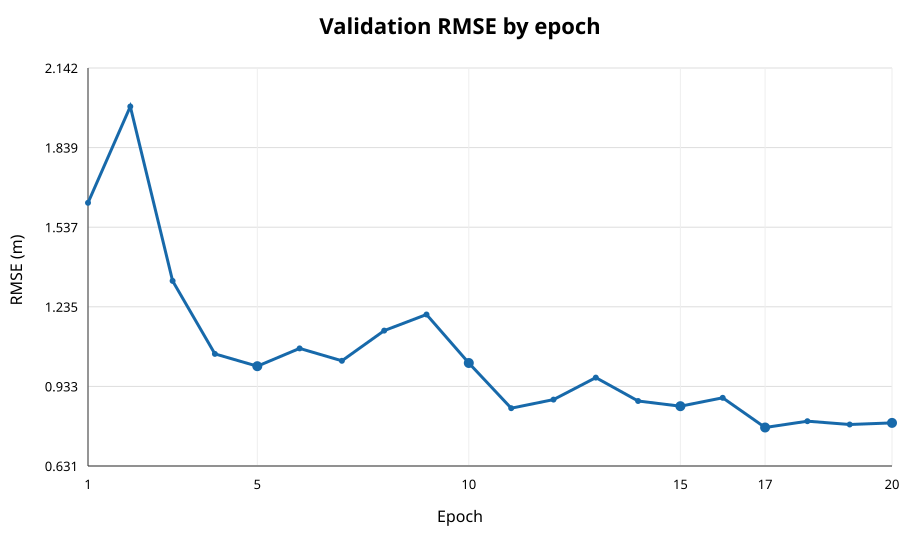
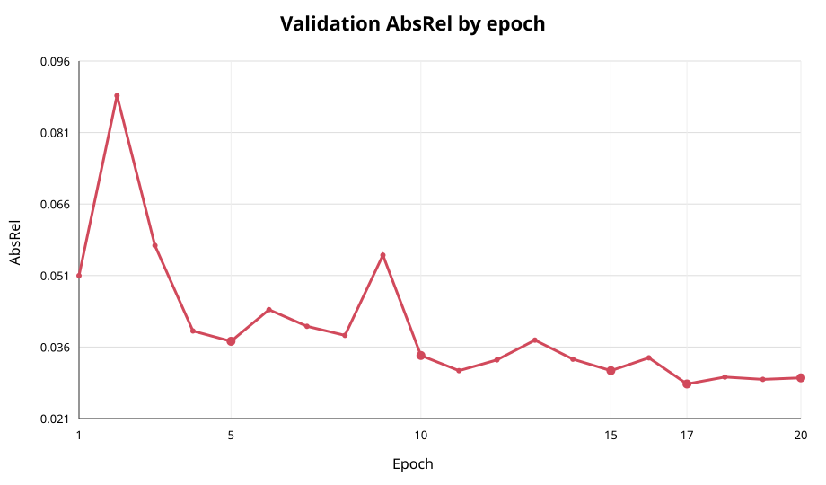
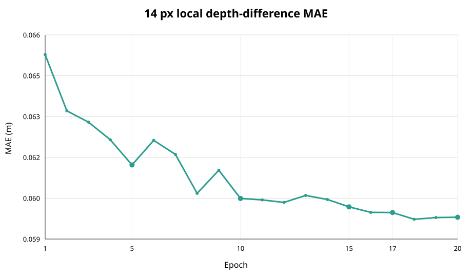
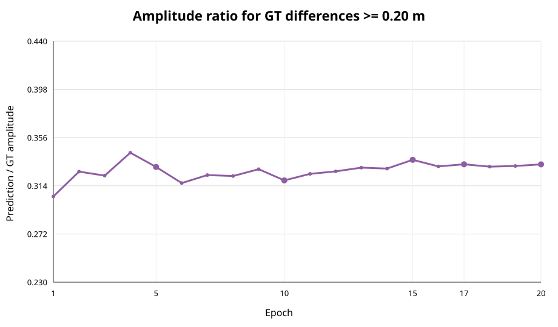
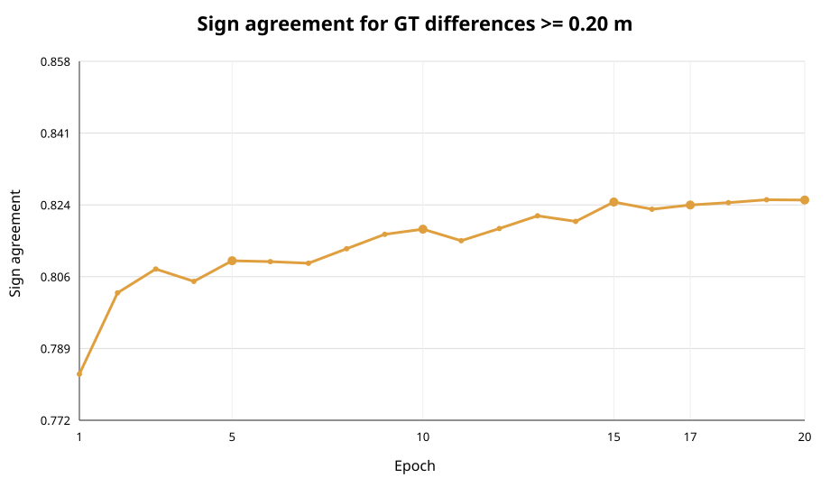

# 第3回 Metric Outdoor Small 20 epoch 学習結果

## 実験状態

元のMetric Outdoor Smallから始めた独立runを、epoch 5 checkpointから継続し、epoch 20/20まで完了した。第3回runのepoch 1〜5はColab Tesla T4、epoch 6〜20は研究室GPGPU4（GTX 1080）で実行した。epoch 5原本とColab runは保持されており、移行用run側だけを継続した。学習・推論の再実行はこの集計作業では行っていない。

データはtrain 384組、validation 128組であり、independent test 319組および過去の52組は使用していない。GTはカメラ座標系のZ-depthであり、植物の垂直高さそのものを評価するものではない。

## 全epochの主要指標

以下の絶対深度指標と14 px局所差MAEはvalidationの全有効画素／全有効ペアによる。GT差分別、画像端、撮影方向・作物別の詳細局所指標は同じ固定標本（25,552,938 valid pairs）による。標本指標を全ペア指標と混同しない。

|Ep|Train SiLog|MAE m|RMSE m|AbsRel|Pearson|14px全ペア局所MAE m|GT≥20cm標本MAE m|振幅比|符号一致|時間 min|AMP skip|
|---:|---:|---:|---:|---:|---:|---:|---:|---:|---:|---:|---:|
|1|0.10622|1.0791|1.6299|0.05088|0.9805|0.06537|0.35276|0.3046|78.28%|18.1|1|
|2|0.05288|1.7002|1.9953|0.08907|0.9884|0.06339|0.34543|0.3263|80.24%|17.4|0|
|3|0.03596|1.0492|1.3334|0.05726|0.9894|0.06299|0.34708|0.3228|80.82%|18.3|0|
|4|0.03025|0.7744|1.0562|0.03913|0.9901|0.06237|0.34495|0.3428|80.52%|17.1|0|
|5|0.02794|0.7373|1.0094|0.03694|0.9919|0.06148|0.34090|0.3304|81.02%|17.0|0|
|6|0.03245|0.8234|1.0773|0.04366|0.9925|0.06235|0.34471|0.3163|81.00%|18.1|0|
|7|0.02454|0.7848|1.0302|0.04012|0.9904|0.06185|0.34261|0.3233|80.96%|18.3|0|
|8|0.02239|0.7906|1.1449|0.03821|0.9921|0.06048|0.34217|0.3225|81.31%|18.2|0|
|9|0.02184|0.9930|1.2060|0.05522|0.9932|0.06129|0.33854|0.3284|81.66%|18.1|0|
|10|0.02163|0.7015|1.0219|0.03392|0.9932|0.06030|0.34050|0.3187|81.78%|18.1|0|
|11|0.01869|0.6109|0.8500|0.03071|0.9935|0.06025|0.34022|0.3243|81.50%|18.2|0|
|12|0.01771|0.6423|0.8830|0.03300|0.9933|0.06016|0.33846|0.3265|81.80%|18.2|0|
|13|0.01648|0.7034|0.9664|0.03720|0.9928|0.06041|0.33869|0.3298|82.10%|18.3|0|
|14|0.01548|0.6415|0.8774|0.03316|0.9933|0.06026|0.33912|0.3289|81.97%|18.2|0|
|15|0.01429|0.6070|0.8579|0.03070|0.9934|0.06000|0.33772|0.3366|82.44%|18.4|0|
|16|0.01344|0.6416|0.8895|0.03344|0.9933|0.05981|0.33736|0.3308|82.26%|18.2|0|
|17|0.01254|0.5529|0.7770|0.02789|0.9945|0.05980|0.33642|0.3327|82.37%|18.2|0|
|18|0.01259|0.5738|0.8007|0.02935|0.9944|0.05957|0.33703|0.3306|82.42%|18.3|0|
|19|0.01138|0.5669|0.7881|0.02885|0.9945|0.05963|0.33641|0.3313|82.49%|18.2|0|
|20|0.01079|0.5735|0.7942|0.02919|0.9944|0.05964|0.33618|0.3327|82.48%|18.2|0|

## 主な結果

- validation RMSE最良はepoch 17（0.77696 m）。最終epoch 20は0.79424 mであり、17よりわずかに悪化した。
- epoch 5から20でMAEは0.7373 mから0.5735 m、RMSEは1.0094 mから0.7942 m、AbsRelは0.03694から0.02919へ改善した。 epoch 20 Pearsonは0.99437。
- 14 px全ペア局所差MAEはepoch 5の0.06148 mからepoch 20の0.05964 mへ小幅に改善した。最小値はepoch 18の0.05957 m。
- GT差分20 cm以上の固定標本では、MAEがepoch 5の0.34090 mからepoch 20の0.33618 m、符号一致率が81.02%から82.48%へ改善した。振幅比は0.3304から0.3327でほぼ変わらず、GT差分振幅の約3分の1しか出せていない。GT平均差分0.4437 mに対し予測平均振幅は0.1476 mである。
- 全局所差MAEは低下した一方、低差分域（GT 0〜5 cm）のMAEもepoch 5の0.02852 mからepoch 20の0.02684 mへ低下した。低差分を含む総合指標と大きな差分の振幅再現は別の性質である。
- epoch 20の画像端128 px未満の標本局所MAEは0.07563 m、内部512 px以上は0.05568 mであり、画像端側に誤差が残る。epoch 5のそれぞれ0.08095 m、0.05678 mからは改善した。
- epoch 20のNadir RMSEは0.62562 m、Obliqueは0.93333 m。作物別RMSEはCorn 0.88871 m、Oat 0.65449 m、Soybean 0.97664 m、Wheat 0.59285 m。これらは画像・画素の集計であり、独立な画像数と混同しない。
- epoch 6〜20のAMP skipは0回。各epochはおよそ18.2分で、ピークVRAMはallocated約2.26 GiB、reserved約2.47 GiB。

## 他モデルとの比較

同一validation上の既報値では、未学習Metric Outdoor（B）のRMSEは14.5340 m、Metric Outdoorを1 epoch追加学習したCはRMSE 1.7490 m・MAE 1.1324 m・AbsRel 0.05208・Pearson 0.9773・14 px局所MAE 0.06800 mであった。20 epoch runのepoch 20はこれらの絶対深度指標を改善した。ただし、CとDでは総scheduler期間等が異なるため、差を純粋なepoch数の効果と解釈しない。

## 図

図1　validation RMSE。点は各epoch、横軸はepoch数を示す。

図2　validation AbsRel。点は各epoch、横軸はepoch数を示す。

図3　14 px全ペア局所深度差MAE。点は各epoch、横軸はepoch数を示す。

図4　GT差分20 cm以上の振幅比。点は各epoch、横軸はepoch数を示す。

図5　GT差分20 cm以上の符号一致率。点は各epoch、横軸はepoch数を示す。

## 保存・再現性・後始末

集計元はprovenance.json記載のepoch 1〜5記録とGPU4のepoch 6〜20実行ログである。各checkpointのcomplete markerとSHA256を最終監査し、epoch 17（RMSE最良）およびepoch 20（最終）を研究室NFSの別バックアップ先へコピーしてハッシュ照合した。GPU4の実験runはlocaldataに残した。

epoch 20終了後の最終監査ジョブとバックアップジョブはいずれもexit code 0。nvidia-smiは15 MiB / 8192 MiB、utilization 0%、GPU計算アプリなしを確認。Singularity instanceはなし。学習プロセスなし。SSH workerはsession_closedを記録して終了し、未完了ジョブなし。外側SSHのexit codeは255として記録されたため、接続クライアント上の終了コードは正常値とは扱わないが、リモート側のsession_closedと無処理状態を確認した。

## 限界と判断

RMSE最良はepoch 17、局所全ペアMAE最良はepoch 18、20 cm以上の差分MAEと符号一致率はepoch 20が最良であり、単一の「最良checkpoint」は目的依存である。大きな局所差の振幅比はepoch 20でも約0.333で、主要課題として残る。validationはDay047の128画像であり、独立test、複数seed、稲の深度GT・垂直草丈GTによる評価を行っていない。epoch 20の検証結果から稲高精度を主張できない。

次の段階では目的に応じてepoch17とepoch20を保持し、固定したvalidation指標と画像単位の結果を比較する。その後、局所差損失や高解像度tile、画像端対策を独立runとして設計し、まずvalidation上で事前登録した指標を検証してから稲高GTで評価する。今回の学習は完了済みであり、残りepochの実行はない。

## ファイル一覧

- epoch_metrics_1_20.csv / .json：全epoch集計および詳細原データ
- group_metrics_1_20.csv：作物別・撮影方向別のvalidation集計
- figures/curve_*.svg：epoch 1〜20の5学習曲線
- run_status_gpgpu4.json：継続runの完了状態を記録
- provenance.json：入力ログのハッシュ、checkpoint検証情報、後始末結果を記録（生ログは非公開の実験アーカイブに保管）
