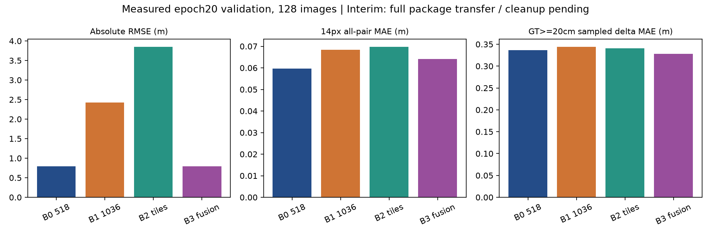

# 多スケール・タイル推論：転送中断時点の中間記録

記録：2026-10-16T02:04:49+09:00

**最終完了報告ではない。** GPU上の推論・評価は完了し、約148MBの結果パッケージも作成済み。Windowsの接続クライアントの状態ファイル更新がWinError5で停止したため、転送の再認証が必要である。推論の再実行は不要。

## 実施済み

9月20日の正本を確認し、20epoch完了commit 3de99b0からresearch/multiscale-tile-inference-20261016を作成。epoch17/18/20のB0再現、3 checkpointの多スケール診断、固定16枚のpilot、epoch17/20の4方式×全128枚を実行した。追加学習・モデル重み更新なし。独立test319組・過去52組は未使用。

固定ソース81件・正式署名10件のSHA256照合、Windows CPUテスト43件は合格。GTはカメラ座標系Z-depth（m）であり、稲の鉛直草丈を評価したものではない。

## 確認済みのepoch20結果

全方式128画像、同一GT mask。14px全ペアは5,320,891,492ペア、GT≥20cm指標は固定標本の1,911,836ペア。数値ファイルの個別SHA256を確認済みだが、転送パッケージ全体の最終SHA256検証は未完了。

|方式|RMSE m|14px全ペアMAE m|GT≥20cm MAE m|振幅比|符号一致率|
|---|---|---|---|---|---|
|B0|0.7942|0.05964|0.33618|0.3327|82.48%|
|B1_1036|2.4203|0.06842|0.34448|0.3862|81.91%|
|B2_t2000_o25|3.8536|0.06983|0.34082|0.4663|83.19%|
|B3|0.7940|0.06406|0.32801|0.4014|84.63%|

B1の全体高解像度化、B2のタイル単独では絶対深度精度が悪化した。B3はB0の低周波成分とタイルの高周波成分を、GTを使わない215×215 box filterで融合する方式。大差分のMAEは約2.43%低下し振幅比も増えたが、約0.40に留まり、全14pxペアMAEは悪化した。全面的な改善とは扱えない。

## 標本と不確実性

固定標本の14/28pxでは画像index101/107にGT≥20cmペアが0、56/107/214pxではindex101が0だった。全画像の推論・絶対評価は維持し、該当する画像MAEは未定義として保存。0で埋めず、画像平均差は共通に定義できる126/127枚、統合MAE差は全128画像を単位とする対応付きcluster bootstrapで扱う。単一撮影日の相関画像であり、別日への汎化を示す区間ではない。

## 未完了

結果パッケージ残部の転送と全体SHA256、境界・全画像差分の最終集計、比較画像のWindowsでの仕上げ、詳細最終報告書、NFSバックアップと最終GPU/SSH後始末監査、commit/push/新規PR。これらを完了したとは記述しない。

再開用クライアント：<Windows正本repo>\work\multiscale_ssh\gpu4_session_client_v4.py。WindowsのPSプロンプトから実行し、パスワードはターミナルでのみ入力する。

データ出典：Link-Dev [UAV3DCrop](https://huggingface.co/datasets/Link-Dev/UAV3DCrop) / [UAV3DCrop Depth](https://huggingface.co/datasets/Link-Dev/UAV3DCrop_depth)、CC BY 4.0。図は評価指標を可視化した加工物。