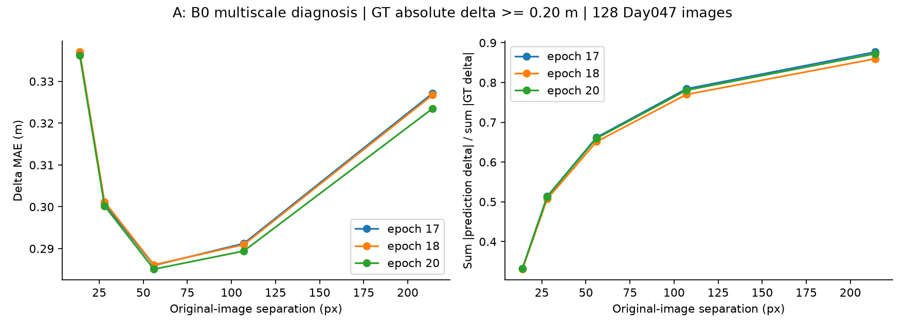
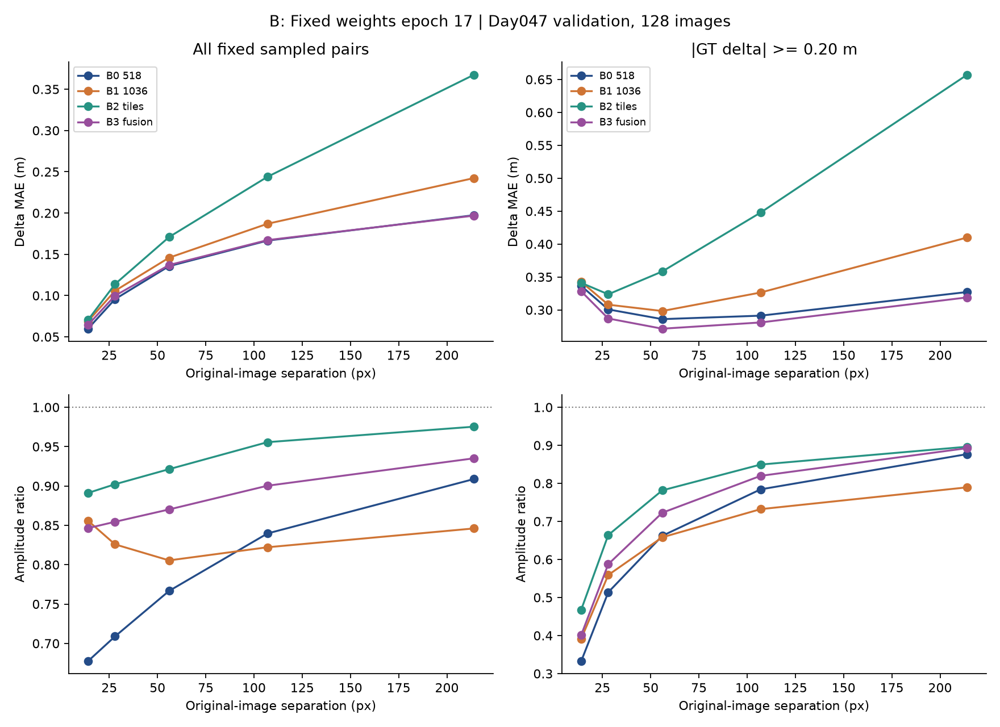
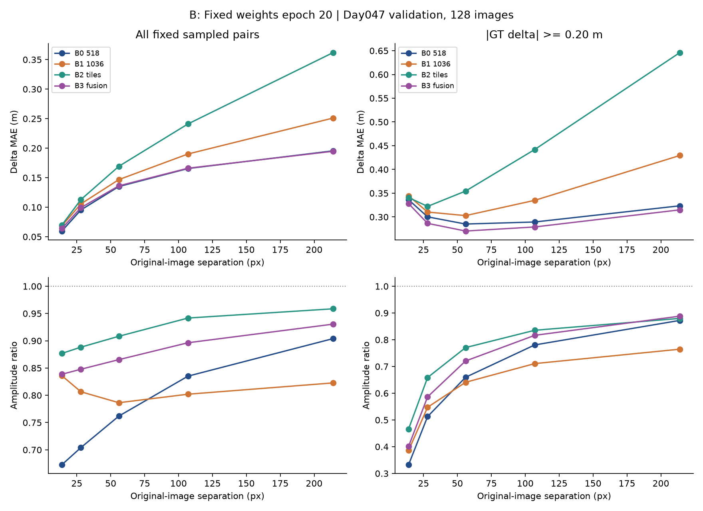
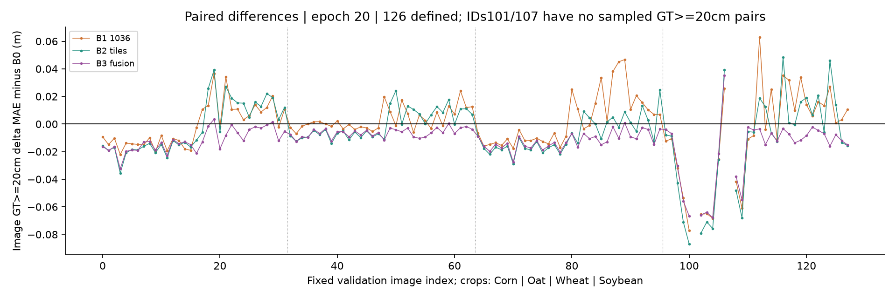
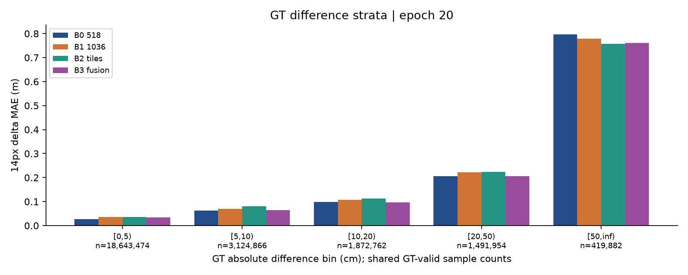
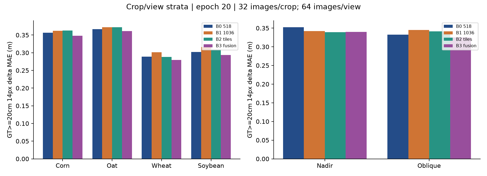
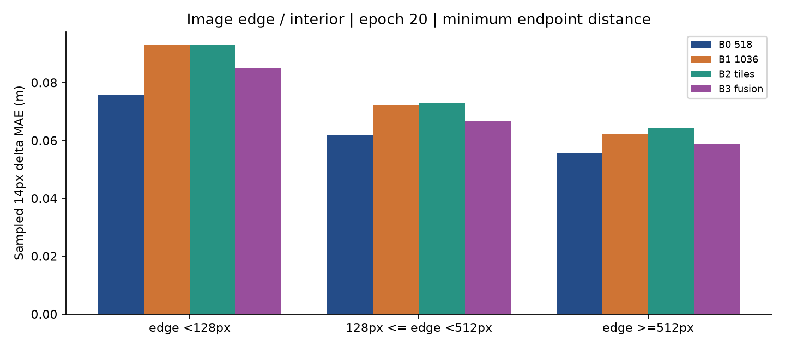
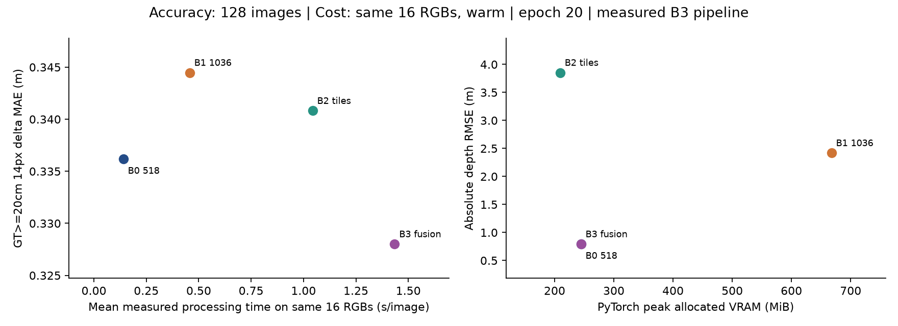

# Depth Anything V2の多スケール診断と高解像度・タイル推論の比較研究

実験ID：`multiscale_tile_inference_20261016`。Day047 validation 128画像による探索的比較。追加学習・重み更新なし。

## 1. 研究背景と今回の到達点

Depth Anything V2 Metric Outdoor SmallをUAV農作物画像へ適応させた20epochモデルは、絶対Z-depthの精度を改善した一方、元画像14pxでの大きな深度差の振幅を約3分の1に過小推定していた。本実験は、入力縮小で局所情報が失われるという仮説を、多スケール診断と重みを固定した推論方式の比較で調べた。

本報告のGTは写真測量由来の**カメラ座標系Z-depth（m）**である。世界座標の鉛直草丈ではない。草丈にはカメラ姿勢・3次元位置・地表面との対応が必要であり、本実験から稲の草丈誤差を主張しない。

今回の主要結果は次の実測表にまとめる。B0のepoch17・18・20は既報のvalidation値を再現した。方式間の数値はすべて同じ128画像、GT mask、局所ペアによる。改善・悪化を隠さず、全ペア局所精度と大差分の再現を区別する。

|epoch20方式|絶対RMSE m|14px全ペアMAE m|GT≥20cm MAE m|GT≥20cm振幅比|符号一致率|
|---|---|---|---|---|---|
|B0|0.7942|0.05964|0.33618|0.3327|82.48%|
|B1|2.4203|0.06842|0.34448|0.3862|81.91%|
|B2|3.8536|0.06983|0.34082|0.4663|83.19%|
|B3|0.7940|0.06406|0.32801|0.4014|84.63%|

## 2. 正本・既存成果の保護

正本は2026-09-20のWindows研究リポジトリ。開始時のHEADは `3de99b0f35e9083c2c74426a57c44014c6b032c2`、新ブランチは `research/multiscale-tile-inference-20261016`。PR baseは `research/gpgpu4-migration-20261015`（[PR #3](https://github.com/hw02l/depth-anything-v2-uav-rice-research/pull/3)）。PR #3は `research/local-first-20261014` への依存PRであり、mainを最新成果とみなしていない。PR #1・#2・#3をマージ・クローズ・書き換えしていない。開始時の未追跡資料も保持した。

固定source_full_v1、旧run、原ログ、分割manifest、checkpointは編集せず、新コードと結果を独立させた。固定ソース81件と正式署名10件のSHA256を検証した。実モデルはeval、inference_mode、FP32、requires_grad=False。optimizerを復元せず、学習は実施していない。

## 3. データと事前固定

Trainは384組（Day019/028/040）、validationは128組（Day047）。今回の推論・GT分析はvalidationのみで、独立test319組と過去52組のRGB/GTは未使用。作物はCorn/Oat/Wheat/Soybean、各32画像。Nadir/Obliqueは各64画像、作物×方向8群は各16画像である。

実ファイルを確認した128画像はすべて5280×3956px。有効GTは `isfinite(d) and 0 < d <= 65m`、モデルhead上限は80mで、両者を混同しない。共通有効画素数は2,668,757,375。方式ごとに予測不正値を除外してmaskを変えることはせず、不正値・座標不一致があれば画像全体を停止する設計とした。

Pilotは各作物×方向16画像をGT深度中央値で並べ、順位floor(n×0.25)、floor(n×0.75)の各1枚、計16枚を予測前に固定した。中央値はGTを縦横16px間隔で標本化した推定値で、並び同値はimage_relpathで決める。選択ID・深度範囲・寸法・RGB/GTハッシュは [pilot_selection.csv](pilot_selection.csv)、[image_inventory.csv](image_inventory.csv) にある。GTは評価とpilot選定にのみ使い、推論時のスケール合わせには使わない。

## 4. 前処理と空間スケール

B0は固定source_full_v1/data.pyとmetrics.pyのvalidation手順に合わせた。短辺基準サイズで拡大縮小し、縦横をそれぞれ最も近い14の倍数へ丸める。RGBはOpenCV bicubic、ImageNet mean/stdで正規化。validationではcrop・padding・flipを行わない。出力を元解像度へ戻す補間はPyTorch bilinear、align_corners=Trueである。

B0入力は高さ518×幅686、B1は1036×1386。アスペクト比は概ね維持されるが、独立した14倍数丸めで厳密には一致しない。B0の縦横倍率は518/3956と686/5280、B1は1036/3956と1386/5280である。RGBリサイズは半画素中心、出力復元のネイティブ座標は `y*(h_native-1)/(H-1)` と `x*(w_native-1)/(W-1)`。この既存の組合せを保持した。

|元画像距離 px|B0入力相当・縦 px|B0入力相当・横 px|B0 patch間隔相当|
|---|---|---|---|
|14|1.833|1.819|0.131|
|28|3.666|3.638|0.262|
|56|7.333|7.276|0.524|
|107|14.011|13.902|1.001|
|214|28.021|27.804|2.002|

DINOv2のpatchは入力14pxで、B0では元画像の約107pxに相当する。元画像14pxは入力約1.8px、約0.13patchである。ただし、これだけからモデルがsubpatch情報を全く表現できないと断定はしない。B1と2000pxタイル518入力のpatchの元画像換算はともに約54pxで、実効的な視覚スケールが近い。入力解像度だけでなく文脈・丸め・位置埋め込み・学習時の入力分布も変わりうる。

## 5. 比較方式

B0：短辺518の全体推論。B1：短辺1036の全体推論。B2：元画像から正方形タイルを切り出し、各タイルを518×518で推論し、各cropの元座標へ復元して加重平均する。タイル順序、座標、重みはコードで固定した。重みは `max(hann(h),0.001) ⊗ max(hann(w),0.001)` で、画像外周を含め全画素の重み合計が正となる。paddingはない。

Pilot候補は1500/2000px×公称重複10/25%の4条件。最後の開始座標は画像の遠端に固定するため、**最終タイルの実際の重複は公称値より大きい**。確定した2000px・公称25%は、y開始=[0,1500,1956]、x開始=[0,1500,3000,3280]の12タイルである。最後の重複は縦77.2%、横86.0%となり、一様な25%重複ではない。実装上のこの非一様性も再現条件・限界として明記する。

|pilot候補|16画像×2checkpointの画像平均MAE m|ep17 RMSE m|ep20 RMSE m|平均秒/枚|
|---|---|---|---|---|
|B1_1036|0.34243|2.7611|3.1753|0.489|
|B2_t1500_o10|0.33455|4.8735|4.9401|0.821|
|B2_t1500_o25|0.33462|4.8452|4.9080|1.357|
|B2_t2000_o10|0.33211|3.8361|3.8648|0.798|
|B2_t2000_o25|0.33114|3.7531|3.7927|1.061|

16画像それぞれのepoch17/20のGT≥20cm・14px MAEを平均し、その画像平均が最小のタイル方式を固定した。32ケースを32独立画像とは扱っていない。選択結果は2000px・公称25%。RMSE・時間は同点時の副基準とし、不都合な画像を除外していない。全128枚の結果を見てパラメータを再選択していない。

### B3：GTを用いない全体・局所融合

タイルのpilot RMSEが対応するB0の1.5倍を超えたため、事前に定めた1種類の融合を適用した。B=B0、Q=B2、Lを元解像度の215×215正規化box filter（半径107px、BORDER_REFLECT_101）として、

`P3 = B + α[(Q − L(Q)) − (B − L(B))]`, `α=1`

すなわち `P3 = L(B) + Q − L(Q)`。B0の低周波成分とタイルの高周波成分を組み合わせる。GTによるscale/offset推定、画像別の係数調整、半径・αの事後探索はない。GTはP3の生成後に評価用として初めて読む。周波数分離は局所構造が常に正しいことを保証せず、ノイズやタイルの歪みも残しうる。

## 6. 指標・標本・統計

局所差は `Δd=d(i)−d(j)`、`Δp=p(i)−p(j)`。MAEは平均`|Δp−Δd|`、RMSEは平方平均誤差の平方根。振幅比は既存と同じ **Σ|Δp| / Σ|Δd|** であり、ペアごとの比の平均ではない。符号一致は`|Δd|>1e−6`を対象に`Δd×Δp>0`で数える。過大・過小振幅は`|Δp|−|Δd|`が±1e−6mを超える割合である。

14px全ペアMAEは元解像度の水平・垂直の全有効ペア（5,320,891,492）から求めた。5スケールの詳細指標は各画像・各軸100,000候補、seed=`42+元のvalidation画像index×10000+距離`、axis0→axis1の固定標本。14px有効標本25,552,938、GT≥20cmは1,911,836で既存研究と一致した。座標SHA256も全方式で照合した。全ペアと固定標本の指標は置き換えない。

GT差分の階級は[0,.05)、[.05,.10)、[.10,.20)、[.20,.50)、[.50,∞)m。位置は両端点のうち画像端に近い方の距離を用い、[0,128)、[128,512)、[512,∞)px。両端の区域の組合せも0/1/2の対として保存した。GT深度階級には2端点の平均深度を使う。画素差の正負は上記i−jで統一している。

ゼロ差分基準は14px全ペアで **0.06421224m** を再現した。一方、14px固定標本のゼロ基準は0.06426980m、GT≥20cm標本では0.44369775mである。小さな局所MAEだけでは形状再現の証拠にならない。

不確実性は画像単位で対応付け、10,000回、seed42でbootstrapした。14/28pxの固定標本では画像index101/107にGT≥20cmペアが0、56/107/214pxではindex101が0だった。全128画像の推論・絶対評価は維持し、該当する画像MAEは未定義として保存した。画像平均の差と改善・悪化数は14/28pxで126枚、他の3距離で127枚が対象。未定義MAEを0で埋めていない。別に、全128画像の誤差和・ペア数を画像単位で再標本化するpool指標の対応付きcluster bootstrapも行い、0ペア画像は分子・分母とも質量0として含めた。

符号・crop・方向・位置・尺度別の指標と画像のばらつきはCSVに保存した。同一日の重複撮影画像には相関があり、画像bootstrapでも独立性が完全には満たされないため、区間はDay047内の記述的な目安であり、別日の汎化区間ではない。

## 7. Baseline再現とcheckpoint監査

GPGPU4上でepoch17/18/20のcomplete markerとmodel/config/trainer-stateのSHA256を照合した。epoch17/20は完了provenanceのハッシュとも一致。保存attention名と実行時名の96キー差を監査し、287テンソルをstrict=Trueでロード後、全値の一致を確認した。署名検証やstrict loadを無効化していない。初回の直接ロードが停止した事実と復旧監査も記録した。

|epoch|再現RMSE m|再現14px全ペアMAE m|既報との照合|
|---|---|---|---|
|17|0.7769630625|0.0598047555|合格・主要指標一致|
|18|0.8007420436|0.0595661784|合格・主要指標一致|
|20|0.7942392449|0.0596389885|合格・主要指標一致|

## 8. 実験A：多スケール診断

以下はepoch20、同一固定標本規則による実測。スケールを変えるとGT≥20cmの標本構成と数が変わるため、振幅比の変化だけを細部改善と解釈しない。

|元画像 px|全標本MAE m|全標本RMSE m|GT≥20cm MAE m|振幅比|符号一致率|GT≥20cmペア数|
|---|---|---|---|---|---|---|
|14|0.05969|0.16719|0.33618|0.3327|82.48%|1,911,836|
|28|0.09535|0.21915|0.30023|0.5126|83.81%|4,172,625|
|56|0.13505|0.27204|0.28508|0.6596|85.04%|7,515,740|
|107|0.16554|0.31480|0.28941|0.7806|87.36%|10,100,760|
|214|0.19549|0.35766|0.32348|0.8723|88.74%|11,346,793|

図A。epoch17/18/20はいずれも14pxで強い振幅圧縮があり、距離が大きくなるにつれて振幅比が1へ近づく。GT≥20cmの割合も14px約7.48%から214px約44.41%へ変わる。粗い尺度では視点や面の傾きによる大局的Z-depth差も含まれ、植物の細かな凹凸だけを見ているわけではない。

## 9. 実験B：全128画像の方式比較

### epoch 17

|方式|MAE m|RMSE m|AbsRel|Pearson|14px全ペアMAE m|
|---|---|---|---|---|---|
|B0|0.5529|0.7770|0.02789|0.99453|0.05980|
|B1|1.4791|2.1273|0.06818|0.97416|0.06882|
|B2|2.5873|3.8443|0.11166|0.91212|0.07045|
|B3|0.5526|0.7763|0.02788|0.99454|0.06446|

|方式|GT≥20cm MAE m|同RMSE m|振幅比|符号一致率|有効ペア数|
|---|---|---|---|---|---|
|B0|0.33642|0.57139|0.3327|82.37%|1,911,836|
|B1|0.34257|0.56667|0.3915|81.86%|1,911,836|
|B2|0.34108|0.55964|0.4678|83.00%|1,911,836|
|B3|0.32819|0.55428|0.4014|84.46%|1,911,836|

### epoch 20

|方式|MAE m|RMSE m|AbsRel|Pearson|14px全ペアMAE m|
|---|---|---|---|---|---|
|B0|0.5735|0.7942|0.02919|0.99437|0.05964|
|B1|1.6100|2.4203|0.07260|0.96706|0.06842|
|B2|2.5973|3.8536|0.11219|0.91144|0.06983|
|B3|0.5731|0.7940|0.02917|0.99437|0.06406|

|方式|GT≥20cm MAE m|同RMSE m|振幅比|符号一致率|有効ペア数|
|---|---|---|---|---|---|
|B0|0.33618|0.57107|0.3327|82.48%|1,911,836|
|B1|0.34448|0.56832|0.3862|81.91%|1,911,836|
|B2|0.34082|0.55918|0.4663|83.19%|1,911,836|
|B3|0.32801|0.55380|0.4014|84.63%|1,911,836|

### 画像単位の対応付き差分

負の差分を改善とする。以下の平均差はGT条件で定義できる126画像のMAE差の平均であり、全ペアをpoolした上表の差と厳密には異なる。index101/107はGT標本0のため未定義で、推論から除外していない。128画像を独立な撮影日と解釈しない。

|epoch|方式−B0|画像平均MAE差 m|画像bootstrap95%区間 m|定義画像数|改善/悪化/不変|
|---|---|---|---|---|---|
|17|B1−B0|-0.00236|-0.00611 ～ 0.00121|126|67/59/0|
|17|B2−B0|-0.00590|-0.01015 ～ -0.00196|126|77/49/0|
|17|B3−B0|-0.01241|-0.01505 ～ -0.01009|126|121/5/0|
|20|B1−B0|-0.00071|-0.00464 ～ 0.00312|126|68/58/0|
|20|B2−B0|-0.00595|-0.01011 ～ -0.00209|126|79/47/0|
|20|B3−B0|-0.01243|-0.01502 ～ -0.01013|126|121/5/0|

|epoch|方式−B0|全128画像pool MAE差 m|対応付き画像cluster bootstrap95%区間 m|
|---|---|---|---|
|17|B1−B0|0.00614|0.00371 ～ 0.00853|
|17|B2−B0|0.00465|0.00157 ～ 0.00766|
|17|B3−B0|-0.00824|-0.00960 ～ -0.00695|
|20|B1−B0|0.00830|0.00540 ～ 0.01119|
|20|B2−B0|0.00464|0.00157 ～ 0.00763|
|20|B3−B0|-0.00817|-0.00950 ～ -0.00688|

詳細は[paired_differences.csv](paired_differences.csv)、[per_image_metrics.csv](per_image_metrics.csv)、[per_image_multiscale.csv.gz](per_image_multiscale.csv.gz)、[image_variability.csv](image_variability.csv)。すべての画像IDを保持し、悪化画像の除外は行っていない。

## 10. GT差分階級・正負・深度・作物・方向・位置

階級境界は左閉右開、最後は50cm以上。20cm以上という選択で標本の構成が変わるため、各階級のnを図とCSVに示した。

|epoch20のGT差符号|ペア数|B0 MAE m|B1 MAE m|B2 MAE m|B3 MAE m|
|---|---|---|---|---|---|
|正：Δd>1e−6|12,435,312|0.06973|0.08053|0.08490|0.07383|
|負：Δd<−1e−6|7,969,768|0.06888|0.07292|0.07142|0.07127|

|端点平均GT深度|ペア数|B0 MAE m|B1 MAE m|B2 MAE m|B3 MAE m|
|---|---|---|---|---|---|
|0–15m|6,387,514|0.02940|0.03760|0.03704|0.03607|
|15–20m|11,643,837|0.04218|0.04899|0.04990|0.04673|
|20–30m|4,612,206|0.08541|0.08885|0.09937|0.08610|
|30–65m（65含む）|2,909,381|0.15548|0.18208|0.17505|0.16024|

以下の画像数・有効画素数・全14pxペア数はGTで決まり、全方式共通。詳細精度と固定標本ペア数は[group_metrics.csv](group_metrics.csv)に併記した。

|グループ|B0 絶対RMSE m|B1 絶対RMSE m|B2 絶対RMSE m|B3 絶対RMSE m|
|---|---|---|---|---|
|crop=corn|0.8887|2.9360|5.0731|0.8882|
|crop=oat|0.6545|2.5528|3.7795|0.6554|
|crop=wheat|0.5928|2.1734|2.9358|0.5933|
|crop=soybean|0.9766|1.8899|3.2812|0.9756|
|view=nadir|0.6256|1.0197|1.0473|0.6255|
|view=oblique|0.9333|3.2701|5.3529|0.9331|

|グループ|画像数|valid pixels|14px全有効pairs|14px固定標本pairs|GT≥20cm標本pairs|
|---|---|---|---|---|---|
|corn|nadir|16|334,202,880|666,336,896|3,200,000|150,263|
|corn|oblique|16|332,947,152|663,815,514|3,187,852|570,140|
|crop=corn|32|667,150,032|1,330,152,410|6,387,852|720,403|
|crop=oat|32|666,662,844|1,329,156,759|6,383,200|478,298|
|crop=soybean|32|667,062,075|1,329,957,669|6,387,001|332,585|
|crop=wheat|32|667,882,424|1,331,624,654|6,394,885|380,550|
|oat|nadir|16|334,202,878|666,336,888|3,200,000|106,631|
|oat|oblique|16|332,459,966|662,819,871|3,183,200|371,667|
|soybean|nadir|16|334,202,879|666,336,892|3,200,000|35,066|
|soybean|oblique|16|332,859,196|663,620,777|3,187,001|297,519|
|view=nadir|64|1,336,811,448|2,665,347,299|12,799,999|344,703|
|view=oblique|64|1,331,945,927|2,655,544,193|12,752,939|1,567,133|
|wheat|nadir|16|334,202,811|666,336,623|3,199,999|52,743|
|wheat|oblique|16|333,679,613|665,288,031|3,194,886|327,807|

|位置（両端の最小距離）|固定標本pairs|B0 MAE m|B1 MAE m|B2 MAE m|B3 MAE m|
|---|---|---|---|---|---|
|<128px|2,786,536|0.07563|0.09291|0.09295|0.08510|
|128–511px|7,487,285|0.06194|0.07223|0.07273|0.06669|
|≥512px|15,279,117|0.05568|0.06220|0.06425|0.05899|

## 11. タイル境界と全体深度の整合

タイルのcrop開始・終了線を共通の参照線とし、その線を跨ぐ14pxペア、端点が線から14px未満の近傍、近傍以外を評価した。跨ぐペアは近傍の部分集合であり、3群は互いに排他的ではない。同じ線・同じGTペアをB0/B1/B2/B3へ適用したため、境界の難易度そのものと方式差を区別できる。参照線は重複重みで滑らかに統合されるcrop境界で、必ず段差が生じるという定義ではない。

|境界群|ペア数|B0 MAE m|B1 MAE m|B2 MAE m|B3 MAE m|
|---|---|---|---|---|---|
|線を跨ぐ|384,771|0.05339|0.06064|0.06447|0.05941|
|線から14px未満|1,836,785|0.05512|0.06236|0.06605|0.06086|
|それ以外|23,716,153|0.06004|0.06897|0.07016|0.06434|

線を跨ぐ同じGTペアでのB0との差は、B1 0.00725m、B2 0.01108m、B3 0.00602m。正は誤差増加、負は誤差低下を意味する。

B2とB0の予測同士の平均絶対差（各画像の画素平均を画像平均）は2.4051m。この整合量にはGTを使っておらず、どちらが正しいかは別途GT誤差で判断する。

境界ごとの元座標・比較PNG・同一ペアSHA256を保存した。重複タイルの統合前の深度不一致はGTを使わない整合性指標で、統合順序に依存する記述量である。B0との全体的な差もglobal_consistency.csvへ保存した。境界群と内部群ではGT分布が異なるため、群間のMAE大小だけで境界の効果を断定しない。

## 12. 定性的比較図

掲載対象はpilotの各作物×方向で元manifest indexが最初の1枚、計8枚を結果と無関係に固定した。全8群・両checkpointの全体図と境界拡大を保存した。深度は同一画像内でGTの1–99%範囲を全方式に共用し、絶対誤差は0–2m、局所差誤差は0–0.5mに固定。範囲外は色が飽和する。画像別・方式別の独立min/max正規化は行っていない。全体表示は元画像の8px間隔の点を抽出し、局所差は元画像14px・水平方向。定量評価は縮小PNGから計算していない。

### corn / nadir：2025/Day047_Corn/images/576.JPG

### corn / oblique：2025/Day047_Corn/images/385.JPG

### oat / nadir：2025/Day047_Oat/images/32.JPG

### oat / oblique：2025/Day047_Oat/images/110.JPG

### wheat / nadir：2025/Day047_Wheat/images/177.JPG

### wheat / oblique：2025/Day047_Wheat/images/993.JPG

### soybean / nadir：2025/Day047_soybean/images/28.JPG

### soybean / oblique：2025/Day047_soybean/images/169.JPG

## 13. 計算環境・速度・メモリ

GPGPU4、Debian 12、GTX1080 8GB、Singularity --nv、記録済みSIFとprivate siteを使用した。PyTorch2.11.0+cu126、Transformers5.18.0、NumPy2.1.3。Compute Capability6.1の実CUDA試験と実モデル推論に成功。ホストへのパッケージ導入・sudo・ドライバ変更は行っていない。RGB/GT・重み・cache・結果の連続処理はlocaldata上で行った。

以下の速度・VRAMは全方式で同じ16枚を用いる。B0/B1/B2は全128枚実行中の当該16枚、B3はB0→B2→融合を同じモデルで逐次実行した実測で、固定RGB1枚のwarm-up後に測定した。B3の実行出力は全128枚のcacheと16枚で照合した。時間には前処理・モデル・出力復元・融合を含み、RGB読み込み・checkpointロード・評価は含まない。PyTorch allocated/reservedのピークはCUDA contextを含む機器全体の厳密なピークとは異なる。

|epoch|方式|共通測定画像|平均秒/枚|peak allocated MiB|peak reserved MiB|
|---|---|---|---|---|---|
|17|B0|16|0.140|244.6|356.0|
|17|B1|16|0.453|667.6|1036.0|
|17|B2|16|1.048|209.4|292.0|
|17|B3|16|1.443|244.6|364.0|
|20|B0|16|0.140|244.6|356.0|
|20|B1|16|0.457|667.6|1036.0|
|20|B2|16|1.043|209.4|292.0|
|20|B3|16|1.435|244.6|364.0|

全128枚の個別時間、タイル統合時間、融合CPU時間はruntime_metrics.csvに保存。B3の全128枚のseconds列は親処理の実測成分和で、別のend-to-end実測ではない。共通16枚の上表は実測であり、この違いを区別した。OOM・不正値による画像の事後除外はなく、比較対象は全方式128枚で揃った。

## 14. 考察：研究課題への回答

1. **元画像14pxを518入力でどれほど表現できたか。** 入力約1.8px、約0.13patchに当たり、epoch20のGT≥20cm振幅比は0.3327、符号一致率は82.48%。符号の再現と振幅の再現には明確な隔たりがある。

2. **画素間隔を大きくするとどうか。** 28/56/107/214pxの振幅比は約0.513/0.660/0.781/0.872へ増えた。粗い構造の差分を相対的に再現しやすい傾向だが、GT差分分布・標本構成・面の傾きも変わるため、純粋な周波数応答や植物凹凸だけの因果効果ではない。

3. **全体高解像度化で改善したか。** epoch20のGT≥20cm MAEはB0 0.33618mに対しB1 0.34448m、RMSEは0.7942→2.4203m。入力の情報量を増やすだけで改善するという単純な説明は支持されない。

4. **タイルは全体高解像度に比べどうか。** B2のGT≥20cm MAEは0.34082m、振幅比は0.4663。絶対RMSEは3.8536mで、局所の振幅と絶対深度の整合性は別に評価する必要がある。B1と2000pxタイルは実効画素スケールが近く、文脈の切断・cropによる入力分布変化が残る候補である。

5. **境界で誤差が増えていないか。** 第11節の同一境界ペア比較と全8群の拡大図で確認した。単なる近傍/内部の難易度差と方式差を区別する。加重平均により接続しても、絶対深度の不一致や局所形状の誤差が自動的に解消するわけではない。

6. **絶対深度と局所形状は両立できたか。** B3はepoch20のRMSEを0.7940mにし、GT≥20cm MAEは0.32801m、全14px MAEは0.06406mとなった。基準B0の各値と併記し、振幅比だけで優劣を決めない。B3はGTなしで全体深度を保つ診断的な選択肢だが、全ペア精度・境界・画像ごとの一貫性も満たす必要がある。

7. **作物・方向で違いがあるか。** B3のGT≥20cm・14px MAEがB0より低かった群は crop=corn、crop=oat、crop=wheat、crop=soybean、view=nadir、view=oblique、低下しなかった群は なし。これは群ごとの点推定で、群間の独立性や有意差を示すものではない。ObliqueのZ-depth差には視点・地表面の傾きも含まれ、作物と撮影条件を分離できていない。

8. **画像端は改善したか。** 端128px未満の標本MAEはB0 0.07563m、B3 0.08510m。内部512px以上はB0 0.05568m、B3 0.05899mである。端・内部はGT構成も異なり、対応付き画像差と併せて判断する。

9. **解像度と学習損失・構造をどこまで区別できたか。** 重み固定で入力処理の効果は測れたが、学習解像度・loss・backboneのpatch表現・位置埋め込み・全体文脈・GTノイズを独立に操作していない。解像度が唯一の原因であるとも、逆に無関係であるとも結論できない。

10. **局所差損失を導入する価値。** 14pxの振幅圧縮が残り、単純な解像度変更で解決していないため、独立した次実験として検証する価値がある。ただし、GTの写真測量ノイズを増幅する可能性があり、今回の結果はその損失が有効であることを実証してはいない。

## 15. 次の独立実験案（本実験では未実施）

新しいrunとして、同じ初期モデル・分割・20epoch計画・seed・scheduler条件を揃え、SiLog単独とSiLog＋正規化Huber局所差lossを比較する案が考えられる。元画像の14/28/56pxに対応する有効ペアをtrain側だけで定義し、両端のmask、GTノイズ・float16量子化、画像端、絶対深度RMSEとのトレードオフを確認する。λや距離の候補は少数を事前固定し、入力解像度変更とloss変更を同時に増やしすぎない。今回のrun/checkpointは再開・上書きせず、独立testは手法と評価を固定した後の最終検証まで保持する。

## 16. 限界

validationはDay047の128画像のみ。pilot16枚を含む同じvalidationで方式選択・性能報告を行っており、探索的比較である。独立test319組、別撮影日への汎化、稲の深度GT・鉛直草丈GTは未検証。GTはMVS由来で、対応誤り・遮蔽・ノイズを含みうる。float16 TIFFの深度刻みも数cm以下の局所差の解釈に影響する。

タイルは全体文脈とcamera-scaleの手掛かりを失い、最終タイルの重複も非一様。B3のbox filterは境界を含む局所情報を混ぜ、実際の細部と推定ノイズを区別しない。FP32・特定のSmallモデル・GTX1080・特定の推論サイズの結果であり、他実装・他サイズへ一般化しない。大きな標本ペア数は独立した画像数・日数を増やさない。

## 17. 再現・保存・後始末

再現コード・設定・評価標本、ベースライン、全方式のCSV、画像単位の対応差、ランタイム、図、固定pilot、入力・標本ハッシュを本ディレクトリに保存した。CPU単体テスト28件は合格。既存source_full_v1の81ファイルと正式署名10件を照合し、既存学習成果・分割manifest・checkpointを変更していない。検証済み推論アーカイブは148,115,613 bytes、SHA256=bbc7829e60b6d3b12efa48838616de09ef79a7f49f6e45ee08cda1cb4898c073。Windows側でアーカイブ全体と内部ファイルSHA256を検証し、ローカルに複製した。RGB/GT・重み・予測cacheはGitへ含めていない。

GPGPU4の読み取り専用事前確認（2026-10-31 09:22:57 JST）では、nvidia-smi --query-compute-appsは空、w/whoのログイン利用者は0人、Singularity instanceは0件だった。GPUは15MiB（Xorgとgnome-shellの表示用プロセス）で、計算利用は確認されなかった。この記録は後続cleanup開始前の一時点である。

研究成果アーカイブの転送後に始めたローカル予測cache整理は、SSHのConnection resetにより完了通知前に切断された。cleanupの完了receipt、NFS側二次バックアップの最終SHA256、削除対象cacheの最終状態、切断後の自己所有プロセス・コンテナ・SSHの終了状態はまだ監査できていない。したがって、cleanup完了とは記録しない。後続の監査接続はDNSパスワード入力待ちまで進んだが、認証前に停止したため、監査コマンドは実行していない。今回の継続中にGPU・利用者状況を再照会していない。計算自体はすでに完了しており、推論を再実行する理由はない。run_status.jsonとprovenance.jsonにも未確認のまま残した。
## 18. 出典

データ：Link-Dev, [UAV3DCrop](https://huggingface.co/datasets/Link-Dev/UAV3DCrop) / [UAV3DCrop Depth](https://huggingface.co/datasets/Link-Dev/UAV3DCrop_depth), [CC BY 4.0](https://creativecommons.org/licenses/by/4.0/)。両dataset cardを2026-10-31に再確認し、RGBとDepthそれぞれの配布物がCC BY 4.0と明記されていることを確認した。Depth cardのカメラ視線軸Z-depth・m・float16 TIFFという定義も照合した。図は統計、色付け、予測・誤差比較、ROIを加えた加工物。原データそのものは再配布していない。

原論文：[UAV3DCrop: Benchmarking 3D Reconstruction in Repeated Multi-Angle UAV Crop Surveys](https://arxiv.org/abs/2608.06404)。既存20epoch結果は親PR #3とgpgpu4_completion_20261015のprovenance、元の固定source_full_v1に基づく。Depth Anything V2モデル重みは本repoへ再配布しない。
