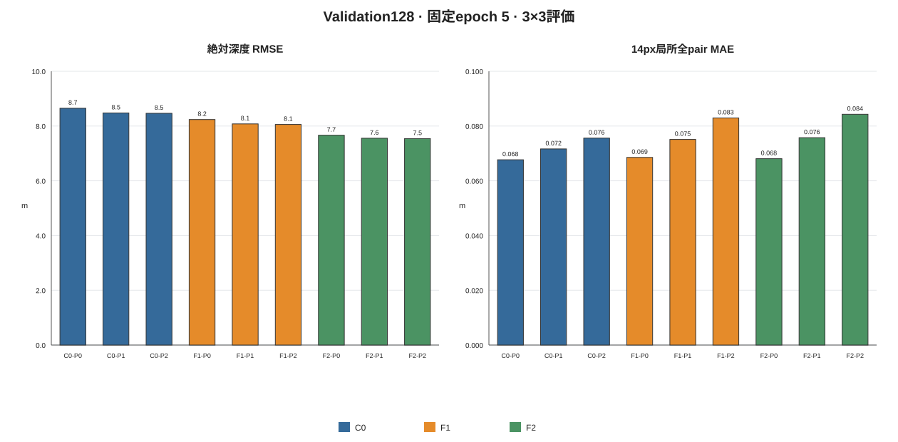

# 元解像度クロップ追加学習による局所深度推定の検証：最終報告

更新日：2026-11-14  
実験ID：native_resolution_patch_training_20261111  
検証データ：UAV3DCrop Validation128（2025/Day047）  
結論：**事前登録した主改善基準を満たさなかった。さらにC0対照の絶対深度値が既存epoch20評価と大きく食い違い、原因未解決のため、実用モデルとしての採用・解像度仮説の確証はできない。**

## 1. 要旨

同じepoch20初期重みから、従来縮小学習C0、1036px cropを518pxへ縮小するF1、518px等倍cropのF2を、それぞれ5 epoch学習した。固定epoch5 checkpointを使い、P0全体縮小、P1 1036pxタイル、P2 518px等倍タイルを組み合わせた9条件をValidation128で評価した。Independent test319は読み込まず、学習・checkpoint選択・評価に使用していない。学習損失は全群SiLogで固定した。

主要比較F2-P2対C0-P2では、GT差20cm以上・14px固定pair MAEがC0の0.447917mに対してF2は0.447938mで、差は+0.000020m、画像単位paired bootstrap 95%区間は[-0.000054, +0.000094]mである。事前目標の5%低減（F2が0.425521m以下）を満たさず、改善は確認できない。F1-P2は+0.001258m（95%区間[+0.001085, +0.001426]m）で悪化した。

F2-P2の絶対RMSEはC0-P2より0.923m低い（比0.891、95%区間[-1.113, -0.704]m）が、F2でも7.542mである。9条件の絶対RMSEは7.542〜8.651m、Biasは-1.221〜-4.330m、Pearsonは-0.465〜-0.086であった。過去の同じ初期epoch20モデルのE0/B0 RMSE 0.794239mと大きく異なるため、この実験の絶対値を既存性能へ連続する結果として扱えない。初期重みのSHA256およびstrict load監査は一致しているが、差の原因は未特定である。

## 2. 背景・目的・事前仮説

過去のUAV3DCrop実験では、epoch20モデルの絶対深度RMSEは0.794239m、14px局所全pair MAEは0.059639m、GT差20cm以上の固定pair MAEは0.336181m、同標本の振幅比は0.332692であった。局所Huber追加学習E1〜E3も主局所MAEを最大1.39%改善したにとどまり、振幅過小推定が残った。

今回の仮説は、元画像を518pxへ縮小することで細部が失われるなら、元解像度の518×518px cropで学習することで14px局所差が改善する、というものである。F1は1036×1036pxから518pxへ縮小する中間条件、F2は518×518px等倍条件である。学習解像度と推論解像度を分離するため、全3学習群を全3推論法で評価した。

成功基準は結果を見る前に固定した。主指標のF2-P2対C0-P2のGT差20cm以上・14px固定pair MAEを5%以上低減し、同方式RMSE比を1.05以下に保つことである。振幅比のみの増加は成功とみなさず、絶対誤差を同時に評価した。

## 3. データ・学習・推論条件

- Train384：Day019/028/040。Validation128：Day047。テスト319画像は今回の処理から除外した。
- 初期重み：既存epoch20 Metric Outdoor Smallのmodel.safetensors SHA256 52769e2e95704d0862e708e8772195b861c647dd4812058eaf698a44305c3bcb。config SHA256 3c6ab05881e6a76edbfd33ff393fdfb082582084e9262826bb1ac0fd2b1dac7c。GPGPU4上の実SHAと一致し、全群でstrict loadおよびloaded values exactがtrueである。
- C0：元画像を短辺518pxへ縮小後、518×518px crop。
- F1：元画像から1036×1036pxを切り出し、518×518pxへ縮小。
- F2：元画像から518×518pxを切り出し、等倍入力。
- 全群共通のseed 42、SiLog、AdamW、batch 1、gradient accumulation 4、encoder LR 2e-6、neck/head LR 2e-5、weight decay 0.01、PolynomialLR power 0.9、CUDA FP16 AMPを用いた。
- 各epochで384画像から2 cropずつ、計768 samplesを供給し、5 epoch・各epoch192 attempted optimizer updates、目標960 updatesとした。F2のcrop coverage候補は480で中央値6.423%、960で12.082%であり、事前規則に従って全群960を固定した。
- F1/F2は学習全体でAMP skipが各2回あり、最終global stepは958。C0は960。epoch5内のskipは全群0である。チェックポイント選択は行わず最終epochを使用した。
- P0：元画像全体を短辺518pxへ縮小。P1：1036px tileを518pxへ縮小。P2：518px等倍tile。P1/P2は25% overlap、stride=round(tile×0.75)、遠端anchor、paddingなし、正Hann窓（下限1e-3）による正規化weighted blendを使い、GTを用いた補正はしていない。
- 評価maskは0<GT<=65m。固定pair manifest、共通Validation順序、14/28/56/107/214px水平・垂直pair集計を使った。

## 4. 学習履歴とepochごとのP0検証

各epochは768 samplesである。平均SiLogは低下したが、P0絶対深度性能は改善しなかった。

### 学習履歴

| 群 | epoch | 累積成功updates | 平均SiLog | 学習時間(s) | epoch内AMP skip |
|---|---:|---:|---:|---:|---:|
| C0 | 1 | 192 | 0.014461 | 1726.2 | 0 |
| C0 | 2 | 384 | 0.013173 | 1714.0 | 0 |
| C0 | 3 | 576 | 0.011963 | 1714.5 | 0 |
| C0 | 4 | 768 | 0.010638 | 1710.0 | 0 |
| C0 | 5 | 960 | 0.009984 | 1711.0 | 0 |
| F1 | 1 | 190 | 0.079128 | 1736.5 | 2 |
| F1 | 2 | 382 | 0.057665 | 1738.8 | 0 |
| F1 | 3 | 574 | 0.049453 | 1733.7 | 0 |
| F1 | 4 | 766 | 0.042755 | 1733.9 | 0 |
| F1 | 5 | 958 | 0.037335 | 1734.0 | 0 |
| F2 | 1 | 191 | 0.102738 | 1728.8 | 1 |
| F2 | 2 | 382 | 0.068071 | 1735.0 | 1 |
| F2 | 3 | 574 | 0.059704 | 1729.7 | 0 |
| F2 | 4 | 766 | 0.053051 | 1703.6 | 0 |
| F2 | 5 | 958 | 0.048261 | 1723.8 | 0 |

### P0 Validation128 RMSEの推移

| 群 | epoch 1 | epoch 2 | epoch 3 | epoch 4 | epoch 5 |
|---|---:|---:|---:|---:|---:|
| C0 | 8.749 | 8.662 | 8.650 | 8.694 | 8.651 |
| F1 | 7.963 | 8.079 | 8.157 | 8.223 | 8.236 |
| F2 | 7.990 | 7.779 | 7.900 | 7.728 | 7.665 |

各epochのMAE、AbsRel、Bias、Pearson、14px全pair MAEは analysis/final_20261114/validation_p0_history.csv に収録した。

## 5. epoch5の9条件評価

| 群 | 推論 | MAE (m) | RMSE (m) | AbsRel | Bias (m) | Pearson | 14px全pair MAE (m) | tiles | runtime (s) |
|---|---|---:|---:|---:|---:|---:|---:|---:|---:|
| C0 | P0 | 4.920 | 8.651 | 0.181570 | -4.330 | -0.347 | 0.067687 | 128 | 7.1 |
| C0 | P1 | 4.842 | 8.478 | 0.180290 | -4.039 | -0.160 | 0.071648 | 4,480 | 211.8 |
| C0 | P2 | 4.839 | 8.465 | 0.180319 | -4.031 | -0.086 | 0.075586 | 17,920 | 719.5 |
| F1 | P0 | 4.804 | 8.236 | 0.185301 | -3.286 | -0.465 | 0.068543 | 128 | 6.7 |
| F1 | P1 | 4.773 | 8.079 | 0.186746 | -3.066 | -0.235 | 0.075102 | 4,480 | 212.5 |
| F1 | P2 | 4.763 | 8.058 | 0.186366 | -3.059 | -0.133 | 0.082972 | 17,920 | 720.2 |
| F2 | P0 | 4.994 | 7.665 | 0.215015 | -1.658 | -0.288 | 0.068077 | 128 | 6.7 |
| F2 | P1 | 5.120 | 7.554 | 0.227466 | -1.230 | -0.164 | 0.075758 | 4,480 | 211.0 |
| F2 | P2 | 5.121 | 7.542 | 0.227665 | -1.221 | -0.094 | 0.084303 | 17,920 | 717.3 |

Peak VRAMはP0が約0.239 GiB allocated / 0.355 GiB reserved、P1/P2が約0.205〜0.207 / 0.286 GiBであった。P0は約1 tile/image、P1は35、P2は140である。

## 6. 主比較・bootstrap・振幅比

paired bootstrapは画像を再標本化単位として10,000回、seed 42で行った。同じValidation画像を対応させ、pooled値と画像平均値を別々に推定した。以下の主指標はpooled推定であり、CIは画像単位bootstrapの95% percentile区間である。

| P2比較 | 指標 | C0 | 候補 | 候補−C0 (95% CI) |
|---|---|---:|---:|---:|
| F1 vs C0 | 14px・GT差≥0.20m固定pair MAE (m) | 0.447917 | 0.449175 | +0.001258 [+0.001085, +0.001426] |
| F2 vs C0 | 14px・GT差≥0.20m固定pair MAE (m) | 0.447917 | 0.447938 | +0.000020 [-0.000054, +0.000094] |
| F1 vs C0 | 絶対RMSE (m) | 8.464965 | 8.057899 | -0.407066 [-0.459889, -0.347186] |
| F2 vs C0 | 絶対RMSE (m) | 8.464965 | 7.542464 | -0.922501 [-1.112623, -0.704451] |
| F1 vs C0 | 14px全有効pair MAE (m) | 0.075586 | 0.082972 | +0.007386 [+0.007058, +0.007713] |
| F2 vs C0 | 14px全有効pair MAE (m) | 0.075586 | 0.084303 | +0.008717 [+0.008352, +0.009077] |

画像平均の主局所MAE差はF1 +0.000782m（95% CI [+0.000502, +0.001007]）、F2 -0.000193m（95% CI [-0.000783, +0.000200]）である。F2の画像平均もCIが0を含み、改善は明確でない。pooled主結果と画像平均の主局所MAE差は analysis/final_20261114/primary_comparisons.csv を参照する。全120比較の完全なpooled・画像平均bootstrap表はNFSバックアップに保存する。

14pxの全有効pair amplitude ratioはC0 0.4239、F1 0.5966、F2 0.6265であり、比だけを見ると1へ近づいた。しかし、14px・GT差≥0.20mの全有効pair（1,911,836組）ではC0 0.0704、F1 0.0961、F2 0.0909に留まる。同じ大差分pairの符号一致率はC0 49.81%、F1 48.71%、F2 51.55%である。固定標本bootstrapの「振幅比1からの距離」もC0 0.9296からF1 0.9039、F2 0.9031への小幅な変化に留まる。振幅の一部増加は、誤差・符号一致・主MAEの改善を意味しない。

## 7. cropサイズ・距離・条件別結果

### P2の距離別14px全pair MAE

| 元画像pair間隔 | C0 | F1 | F2 |
|---:|---:|---:|---:|
| 14px | 0.075643 | 0.083020 | 0.084834 |
| 28px | 0.134682 | 0.146625 | 0.147180 |
| 56px | 0.222357 | 0.235464 | 0.228278 |
| 107px | 0.355039 | 0.367344 | 0.350062 |
| 214px | 0.586442 | 0.660080 | 0.572584 |

F1は全距離でC0より悪い。F2は14/28/56pxで悪く、107/214pxでわずかに良い。元解像度学習が小距離ほど有利というH4は支持されない。

### 作物・撮影方向別（P2、14px全有効pair MAE）

| 条件 | C0 | F1 | F2 |
|---|---:|---:|---:|
| Corn | 0.0951 | 0.1018 | 0.1029 |
| Oat | 0.0760 | 0.0834 | 0.0849 |
| Soybean | 0.0649 | 0.0727 | 0.0740 |
| Wheat | 0.0665 | 0.0715 | 0.0756 |
| Nadir | 0.0453 | 0.0544 | 0.0558 |
| Oblique | 0.1062 | 0.1118 | 0.1120 |

全作物・両撮影方向でF1/F2がC0を上回る。ObliqueのMAEはNadirより高い。

### 深度帯・画像端（P2、14px全有効pair MAE）

| 条件 | C0 | F1 | F2 |
|---|---:|---:|---:|
| GT depth 0–15m | 0.0408 | 0.0501 | 0.0518 |
| GT depth 30–65m | 0.1986 | 0.2026 | 0.2034 |
| 画像端から128px未満 | 0.0945 | 0.1037 | 0.1067 |
| 画像内部512px以上 | 0.0703 | 0.0774 | 0.0786 |

### P2タイル境界・overlap（14px、GT差≥0.20m pair MAE）

| 条件 | pair数 | C0 | F1 | F2 |
|---|---:|---:|---:|---:|
| 両端点がnon-overlap | 834,764 | 0.4611 | 0.4664 | 0.4604 |
| 両端点がoverlap | 1,003,479 | 0.4387 | 0.4360 | 0.4389 |
| seamから<14px | 543,018 | 0.4318 | 0.4361 | 0.4338 |
| seamから14–56px | 945,447 | 0.4432 | 0.4422 | 0.4436 |
| seamから56–107px | 343,037 | 0.4033 | 0.4065 | 0.4595 |
| seamから≥107px | 330,337 | 0.4655 | 0.4665 | 0.4595 |
| overlapに接触 | 10,770,772 | 0.4377 | 0.4358 | 0.4383 |

F2は境界から56–107pxの層でC0より高いが、他の層では差が小さい。境界・overlapで一貫した改善はない。全条件表、画像別CIはNFSバックアップに保存する。

### 画像別の例

- 最大改善例：2025/Day047/Corn/images/55.JPG（Nadir）。GT差≥20cmのpair数4、C0 0.1542m、F2 0.1240m、差-0.0302m。
- 最大悪化例：2025/Day047/Soybean/images/137.JPG（Nadir）。pair数463、C0 0.2606m、F2 0.2652m、差+0.0046m。

これらは画像別差の極端例であり、平均的効果を代表するものではない。決定的な並べ替えで選ばれた上位例を含む完全一覧は analysis/conditions_20261114_rerun1/paired_image_examples.csv に保存した。

## 8. 既存結果との不一致・解釈上の留保

既存E0/B0は同じepoch20モデルをValidation128で再評価し、RMSE 0.794239m、MAE 0.573505m、AbsRel 0.029186、Pearson 0.994368を記録している。今回のC0-P0 epoch1〜5 RMSEは8.650〜8.749mで、epoch5は8.651m、Bias -4.330m、Pearson -0.347である。各群のepoch5 cross-evaluationもこの規模で一致し、複数の結果ファイルに値が反映されている。

今回のC0/F1/F2初期model SHA256は既存epoch20と一致し、run signatureのload auditはstrict load=true、loaded values exact=true、renamed tensors=96、verified tensors=287と記録している。これで初期重みの取り違えは確認されなかった。一方、現在のrunでは学習前epoch0のValidation再評価値を保存していないため、性能がどの時点で崩れたかをこの記録だけから断定できない。新しい学習実装・crop sampling・optimizer更新予算・評価実装の差のいずれが原因かは未解決である。

この大きなcontrol差は研究上の重大な再現性問題である。したがって、今回のC0対F1/F2内の対応比較は報告するが、過去E0/E1との連続性、絶対深度改善、実用性、解像度変更の因果効果を確証したとは結論しない。既定の作業範囲を越える再学習、test評価、GTに基づく補正、fusion実験は実施していない。

## 9. 成功基準と仮説の判定

| 仮説 | 判定 | 根拠 |
|---|---|---|
| H1：F2で14px局所差が改善 | 支持されない | F2-P2主MAE差+0.000020m、95% CIは0を含む。全pair 14px MAEは悪化 |
| H2：F1中間尺度で改善 | 支持されない | 主MAE差+0.001258m、95% CI全体が悪化側 |
| H3：振幅比が1へ近づく | 一部だけ近づくが未達 | 全pair ratio .424→.627、20cm以上pair ratio .070→.091。局所MAE/符号の改善は確認できない |
| H4：小距離ほど改善 | 支持されない | F2は14/28/56pxで悪化、107/214pxのみ小幅低下 |
| H5：cropで全体文脈を失いRMSE悪化 | 因果的には判定不能 | F2のRMSEは同方式C0より低いが、全群の絶対RMSEが過去値から大きく悪化 |
| H6：P0/P2融合で両立 | 今回未実施 | 第一段階で局所改善が確認できず、事前計画どおり対象外 |

総合判定は**失敗（事前成功基準未達）**である。局所振幅比の部分的な増加を成功に置き換えない。

## 10. 限界

- Validation128はDay047単日由来で、結果は同日の記述的評価である。未知撮影日への汎化を示さない。
- 学習seedは42の1種類であり、学習seed間ばらつきは測っていない。
- 画像paired bootstrapは画像標本変動を表すが、撮影日差、学習seed差、実装間差を含まない。
- 写真測量GTには葉・茎境界の平滑化、位置ずれ、再構成誤差がありうる。
- 指標はカメラ座標系Z-depthであり、鉛直方向の稲高精度を意味しない。
- F2 cropが小さいため全体文脈不足がありうるが、今回のC0再現性異常と分離できていない。
- 作物・view・深度帯・画像端・tile seamの層別値は同じValidation128内の相関したpairをpoolした記述値で、独立標本数と解釈しない。

## 11. 解析実行上の補足

条件別解析の初回CPU実行では、有効pairが0件の層を平均化する際にゼロ除算が発生した。空層を未定義値として扱うガードを `analyze_conditions.py` に追加し、別の出力先へ全条件を再実行した。主bootstrapおよびGPU評価はこの修正の対象外で、再計算していない。図の初回生成では実行環境にmatplotlibがなく停止したため、追加依存なしの標準ライブラリSVG生成へ切り替え、3図の生成を確認した。

## 11. 再現・provenance

最終checkpoint SHA256：

| 群 | epoch5 checkpoint SHA256 | successful global step |
|---|---|---:|
| C0 | 2fd190727c7a5124c56c10e0a2dd8cb09c6cb62a0f92b34fce97ad394281b35a | 960 |
| F1 | ea1f74c5ff17c0b266152588b5d53f8b24611418f125f2fbf4d9cc7447e49f67 | 958 |
| F2 | 8124d72a7008c9f3a93dbcce34142d1593063fba2da6a1a58306d55aaf201538 | 958 |

GPGPU4はGeForce GTX1080 8GB、Singularity CE 4.2.2、PyTorch 2.11.0+cu126、Transformers 5.18.0、NumPy 2.1.3である。全9条件の評価完了後はutilization 0%、15MiB使用で、ユーザー所有の学習・推論processは残っていなかった。学習や推論を再実行していない。

再計算スクリプト：
- train_patch.py：C0/F1/F2学習、--mode formal --group C0|F1|F2。
- evaluate_all.py：固定epoch5 checkpointの全9条件評価。config、initial checkpoint、train/val manifest、RGB/Depth root、pair manifest、runs root、output dirを引数で指定する。
- analyze_results.py：--eval-root runs/evaluation_epoch5_20261114_retry3 --output-dir repository/experiments/native_resolution_patch_training_20261111/analysis/final_20261114 --repeats 10000 --seed 42。
- analyze_conditions.py：同じeval rootを入力し、条件別CSV/paired bootstrapを作成する。空pair条件は未定義値として出力し、ゼロ除算しない。
- plot_results.py：stdlibのみでsummary/bootstrap/stride CSVからSVG図3点を生成する。

集計CSV、SVG図、epoch履歴、条件別ハイライト、画像別例のコンパクト版を本ディレクトリに同梱した。詳細なper-image CSV/JSON、完全bootstrapとcondition CSV、全run signature、GPU receipt、ログ、checkpointはGitHubに含めず、専用NFSバックアップへ保存する。RGB/GT画像および巨大prediction cacheはバックアップ対象外とする。

### 図表

- [9条件の全体指標](analysis/final_20261114/figures/figure1_final_metrics.svg)
- [主比較のpaired bootstrap](analysis/final_20261114/figures/figure2_primary_effects.svg)
- [P2距離別局所MAE](analysis/final_20261114/figures/figure3_local_scale.svg)
